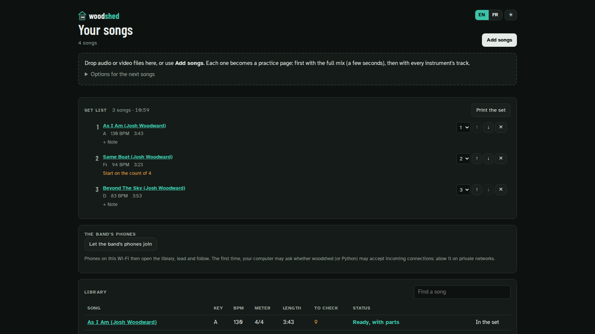
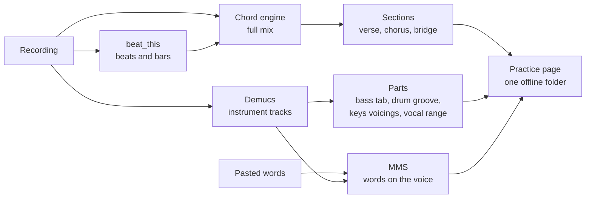

<p align="center">
  <picture>
    <source media="(prefers-color-scheme: dark)" srcset="docs/images/logo-dark.png">
    
  </picture>
</p>

<p align="center"><strong>Turn any recording into a practice room for your whole band.</strong><br>
Chords, lyrics and a part for every instrument, on your own computer.</p>

<p align="center">
  <a href="LICENSE"></a>
  
  <a href="https://github.com/laugiov/woodshed/actions/workflows/ci.yml"></a>
  
  
  
</p>

<p align="center">
  
</p>

```bash
woodshed song.mp3
```

That's it. Within seconds your browser opens a practice page for the song, and a few minutes later
everything is there: the chord chart, the words with the chords above them, a part for guitar,
bass, keys, drums and voice, loops, a tempo trainer and play-along tracks with your instrument
taken out.

Nothing is uploaded. There is no account, no subscription, no ad. The models run on your computer,
and the page is a folder you can open offline, put on a USB stick or send to your drummer.

> *Woodshedding*: musicians' slang for practising alone, hard, until you've got it.

---

## Why woodshed

You have a recording and a rehearsal on Thursday. Chord sites give you a guess with the wrong
voicings, no bar lines and nothing for the bassist or the drummer. Transcribing by ear takes an
evening per song.

woodshed listens to the recording itself. It splits it into instrument tracks, finds the beats,
the bars, the chords and the sections, writes out the bass line and the drum groove, and places the
lyrics on the singer's voice. Then it gives every musician in the band their own way into the song.

---

## What you get

### Chords where they're sung


Press **+ Add the words** on the song page, paste them, and woodshed places them on the singer's
voice, line by line (a progress bar shows how far it is), then puts each chord above the word it
lands on. Bar lines are numbered, pushes are marked, and the line being sung
lights up as the song plays. Click a word to jump there. Instrumental bars stay a grid, so a solo
never hides inside a lyric line.

### A part for every instrument

| Guitar | Bass | Drums |
|:---:|:---:|:---:|
|  |  |  |
| Shapes in open, barre or funk-triad positions, capo suggestions, and when the chords hit in the bar. | The line as played, in tab, bar by bar. Hear any bar on its own. | The main groove in notation, from the isolated drum track, and how often each hit happens. |

| Keys | Voice |
|:---:|:---:|
|  |  |
| The voicing heard on the record, on a keyboard, with the next chord outlined. | The range of the melody against your voice type, and the key that suits you. |

Change the key and everything follows: the chart, the shapes, the tab, the keyboard.

### A method, not just a chart

Every page walks you through the same four steps: **listen** with the full band, **learn** your
part alone, **loop it slow** (from 70 % tempo, 5 BPM faster on each pass) and **play along** with
your own part muted. A count-in, a click and per-instrument tracks are one button away. Drag across
bars to loop them, use a pedal or the arrow keys to move bar by bar. While the song plays, the page
scrolls with it: your hands stay on the instrument.

### English or French, dark or light


The page speaks English or French (your browser's language at first), dark by default or light for
a sunny room: two buttons at the top, remembered, and switched without stopping the music. Chord
names, titles and words are never translated.

### Trust the chart, or fix it


Where the analysis hesitates, woodshed says so instead of guessing quietly. The spots to check are
marked on the chart: press one, hear each candidate chord played over that bar of the recording,
and keep the one your ear agrees with. Your corrections go into the exports, and through the
library every device of the band sees them.

### Built for the rehearsal room


- **Stage mode**: the chord now and next in huge type, the words, where you are in the section.
  Readable from the drum stool, with big buttons for a tablet: previous part, play, next part.
- **Lead and follow**: one device leads, every phone on the network follows to the bar. Start,
  stop, loop and seek once, for the whole band.
- **Set list**: line up the evening's songs. At the end of a song, the pedal (or `N`) takes the
  whole band to the next one.

<p align="center">
  
</p>

### Your library, your exports



`woodshed app` opens your library in the browser. Drop audio or video files on it and each one
becomes a practice page: first with the full mix after a few seconds, then with every instrument's
track. Export any song to **ChordPro** with its words and parts (OnSong, SongbookPro), **MIDI**,
**MusicXML** (MuseScore), a
chord timeline (`.lab`) or **JSON**, or print a one-page chart for the music stand.

**Share a song**: zip its `.woodshed` folder and send it. Unzipped, `index.html` opens in any
browser, offline, with every track, the words and the parts. **After an update** of woodshed, the
library gives every page the new interface when it starts, without analysing anything again.

---

## Install

> **Alpha.** woodshed works on real songs today, but expect rough edges.

No GPU needed, and no Python to install first. On a Mac or a Windows PC, the easiest way is to
download one file and double-click it.

### Download and double-click: Mac and Windows

1. From the [latest release](https://github.com/laugiov/woodshed/releases/latest) (under
   **Assets**), download the installer for your computer:
   - **Mac**: `woodshed-installer-macos.zip`. Double-click it to get **Install woodshed**.
   - **Windows**: `woodshed-installer-windows.cmd`. If your browser asks, choose **Keep**.
2. Double-click it. A window says what it does, then installs woodshed for you only: about 1.5 GB
   to download, a few minutes. No password, no administrator rights.
3. When it says **Done**, woodshed starts and opens your library in the browser. Drop a song on
   the page and play.

**The first time only**, your computer warns you about the installer, because this free project
does not pay Apple or Microsoft to sign it:

- **Mac**: macOS says it cannot check the file. Click **Done**, open **System Settings**, then
  **Privacy & Security**, scroll down and click **Open Anyway** next to "Install woodshed". On
  macOS 14 or older, you can instead right-click the file, choose **Open**, then **Open** again.
- **Windows**: if a blue "Windows protected your PC" box appears, click **More info**, then
  **Run anyway**.

**Next time**, start woodshed like any other app: **woodshed** in Applications, Launchpad or
Spotlight on a Mac, in the Start menu on Windows. A small window opens next to your browser: keep
it open while you play, close it to stop woodshed. Your songs are in the `woodshed` folder of your
home folder.

MP3, WAV, FLAC and Ogg files work as they are. AAC (M4A) and video files need
[ffmpeg](https://ffmpeg.org/download.html): the Windows installer adds it when it can, and on a Mac
`brew install ffmpeg` does it (with [Homebrew](https://brew.sh)).

**To update**, run the installer again. **To uninstall**, open Terminal (Mac) or PowerShell
(Windows) and type `uv tool uninstall woodshed`, then remove the shortcut: on a Mac, drag
**woodshed** from the Applications folder of your home folder to the Trash; on Windows, delete
`woodshed` from the Start menu folder (right-click it, **Open file location**). Your songs stay
where they are.

### With Docker: Windows, macOS or Linux

Nothing to install but [Docker Desktop](https://www.docker.com/products/docker-desktop/) (or Docker
on Linux). On Linux or macOS, one command downloads `compose.yaml` into `~/woodshed-docker`, starts
woodshed, waits until it answers and opens your browser:

```bash
curl -LsSf https://raw.githubusercontent.com/laugiov/woodshed/main/scripts/install-docker.sh | sh
```

Or by hand (also on Windows): in a new folder, save [`compose.yaml`](compose.yaml), then:

```bash
mkdir woodshed            # your songs and their practice pages go here
docker compose up -d --wait
```

Open **http://localhost:8000**, drop a song on the page, and play. The first start pulls the image
(about 2 GB). The first analysis downloads the models (about 160 MB, and 1.2 GB more for the lyrics)
into a Docker volume, once; a song then takes about twice its length to analyse, on a CPU. The
container needs no sound card: your browser plays the music.

Stop it with `docker compose down` (your songs and the models stay). `docker compose down --volumes`
also removes the models.

On Linux, if your user id is not 1000 (`id -u`), start with
`WOODSHED_UID=$(id -u) WOODSHED_GID=$(id -g) docker compose up -d` (the install script does this for
you).

Without Compose: `docker run -d -p 127.0.0.1:8000:8000 --user "$(id -u):$(id -g)" -v "$PWD/woodshed:/library" -v woodshed-cache:/cache ghcr.io/laugiov/woodshed`
(in PowerShell, `${PWD}` instead of `$PWD`, and no `--user`).

### In a terminal: Linux, macOS or Windows

On Linux or macOS:

```bash
curl -LsSf https://raw.githubusercontent.com/laugiov/woodshed/main/scripts/install.sh | sh
```

The script installs [uv](https://docs.astral.sh/uv/) if needed, then woodshed with its own Python
and the CPU build of PyTorch, in your home folder: no sudo, nothing system-wide (uv adds its
folder to your PATH). It adds woodshed to the applications menu on Linux, and the woodshed app to
`~/Applications` on macOS. It tells you how to add [ffmpeg](https://ffmpeg.org/download.html) if it
is missing (only for AAC (M4A) and video files: MP3, WAV, FLAC and Ogg work without it).

On Windows, in PowerShell:

```powershell
powershell -ExecutionPolicy ByPass -c "irm https://raw.githubusercontent.com/laugiov/woodshed/main/scripts/install.ps1 | iex"
```

The same for your user, no administrator rights; ffmpeg comes with winget when it is available,
and woodshed gets a Start menu shortcut. The double-click installers run these same scripts.

Uninstall: `uv tool uninstall woodshed`. Read the scripts before running them if you like:
[install.sh](scripts/install.sh), [install.ps1](scripts/install.ps1), and the double-click
installers in [scripts/installers](scripts/installers).

### By hand

With Python 3.10 or newer and [pipx](https://pipx.pypa.io/) (and ffmpeg for AAC (M4A) and video files):

```bash
pipx install "woodshed[stems] @ git+https://github.com/laugiov/woodshed" \
  --pip-args="--extra-index-url https://download.pytorch.org/whl/cpu"
```

The `stems` extra brings PyTorch and the models that split the instruments and find the beats (the
extra index gets the CPU build of PyTorch, about 1.4 GB, instead of the 5 GB GPU build). Without
it, woodshed still reads the chords from the full mix, but there are no instrument tracks or parts.

On a recent laptop a song takes about twice its length to analyse. The page opens with the full mix
after a few seconds, and the instrument tracks follow.

## Use it

**Try it on the demo song** that comes with the repository, "As I Am" by Josh Woodward (CC BY 4.0):

```bash
git clone https://github.com/laugiov/woodshed && cd woodshed
woodshed "demo/As I Am.mp3"                                # the page opens in your browser
woodshed lyrics "demo/As I Am.woodshed" "demo/As I Am.txt"  # and the words on the chart
```

With Docker, drop `demo/As I Am.mp3` on the library page (http://localhost:8000).

Then on your own songs:

```bash
woodshed song.mp3                           # one song: builds the page and opens it
woodshed ~/Music/setlist/                   # a whole folder: a songbook
woodshed app                                # your library in the browser (songs in ~/woodshed)
woodshed lyrics "Song.woodshed" words.txt   # put the words on a page
woodshed chart song.mp3                     # the chord chart, as text, in the terminal
```

**The whole band, on the local network.** Start the library so the other devices can reach it,
then open it on every phone:

```bash
woodshed app --host 0.0.0.0 --allow-network
```

With Docker, publish the port to the network instead: in `compose.yaml`, `"8000:8000"` in place of
`"127.0.0.1:8000:8000"`.

**The words.** In the library, a song with its parts offers **add the words**; on its page, **Add the
words** next to the chart. Paste them (part names like `[Chorus]` help), press **Place the words**:
a minute later the page shows the chords above the words. From the command line, or for a page
opened from disk: `woodshed lyrics "Song.woodshed" words.txt`.

Useful options: `--bpm 65` settles a half-time or double-time doubt, `--beats-per-bar 3` for a
waltz, `--sevenths` adds 7th chords, `--offline` never downloads models. `woodshed --help` lists
them all.

---

## How it works



- **Separation**: [Demucs](https://github.com/facebookresearch/demucs) (htdemucs) splits the mix
  into vocals, drums, bass and the rest, losslessly cached.
- **Beats and bars**: [beat_this](https://github.com/CPJKU/beat_this) finds beats and downbeats.
- **Chords**: woodshed's own engine (signal processing, no trained model) reads the harmony from the
  full mix, bar by bar, and says where it is unsure rather than guessing.
- **Structure**: lines that come back are grouped into sections and named by their role.
- **Lyrics**: Meta's [MMS](https://pytorch.org/audio/stable/pipelines.html#torchaudio.pipelines.MMS_FA)
  aligns the words you paste on the vocal track.
- **The page** is plain HTML, CSS and JavaScript in one folder. It loads nothing from the internet:
  the repository's CI rejects any page code that points outside. Opened from disk, it makes no
  request at all; the band features talk only to your own library server.

No language model and no cloud service: everything above runs on your computer. The full tour, module
by module: **[Under the hood](docs/architecture.md)**.

## Privacy

Everything runs on your computer: the analysis, the models, the library server (which listens on
this computer only unless you say otherwise). Your recordings, your corrections and your lyrics
never leave it. Your corrections stay in your browser and, when the band shares them, in your own
library.

## Models and licences

woodshed is MIT. The models it downloads come with their own licences:

| Model | Used for | Licence |
|---|---|---|
| Demucs (htdemucs) | Instrument tracks | MIT |
| beat_this | Beats and downbeats | MIT |
| MMS forced aligner (weights, 1.2 GB) | Placing lyrics (optional) | **CC BY-NC 4.0**: non-commercial use |

The page ships VexFlow (MIT) for notation, the FluidR3 GM SoundFont (MIT) for instrument sounds,
and Atkinson Hyperlegible, Barlow Condensed, JetBrains Mono, Noto Music and Bravura fonts (SIL OFL).

**Your songs and lyrics are yours to handle.** woodshed works on the files you give it, on your
computer. Respect the rights on the recordings and lyrics you use, and don't publish pages of songs
you don't have the rights to.

## Status and limits

- Alpha: the core (chart, sections, lyrics, parts, band mode) works, and the page is tested in
  Chromium and Firefox on every push and pull request. Installation will get simpler.
- The bass tab and the drum groove are marked experimental in the page.
- Chords are triads by default; `--sevenths` adds 7 and m7 chords, less reliably.
- Lyrics: Latin letters only (most accented letters are fine); write numbers out as words ("twenty", not "20").

## Development

```bash
git clone https://github.com/laugiov/woodshed && cd woodshed
uv sync --extra stems
uv run pytest -n auto                     # Python and page tests (Playwright)
scripts/ci.sh                             # the quick local CI
```

Issues and pull requests are welcome: see [CONTRIBUTING.md](CONTRIBUTING.md). Security problems go
through [private reporting](SECURITY.md).

## Credits

The screenshots show woodshed's analysis of four songs by
[Josh Woodward](https://www.joshwoodward.com/), from the album *The Shade from Our Trees*:
[As I Am](https://www.joshwoodward.com/song/AsIAm),
[Same Boat](https://www.joshwoodward.com/song/SameBoat),
[Beyond the Sky](https://www.joshwoodward.com/song/BeyondTheSky) and
[The Rival Within](https://www.joshwoodward.com/song/TheRivalWithin), licensed under
[CC BY 4.0](https://creativecommons.org/licenses/by/4.0/). The images show woodshed's chords, parts
and excerpts of the lyrics placed on the recordings. The [`demo/`](demo/) folder ships "As I Am",
recording and lyrics, unchanged ([details](demo/LICENSE.md)). Thank you, Josh, for making your music
free to use.

## License

[MIT](LICENSE) © Laurent Giovannoni
