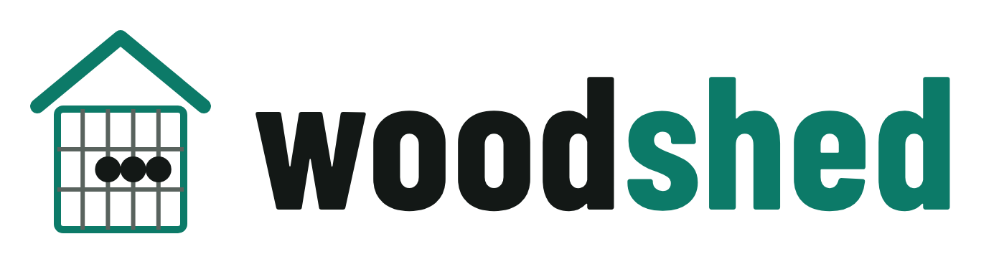
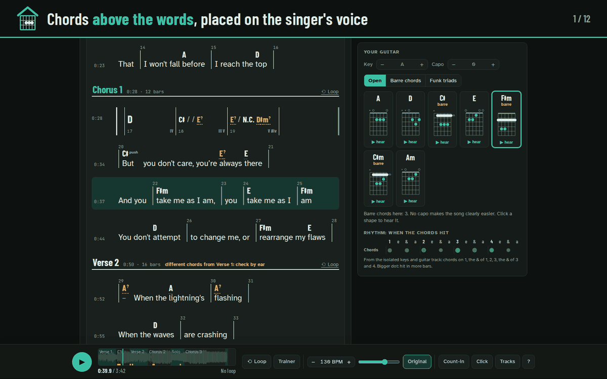

  <picture>
    <source media="(prefers-color-scheme: dark)" srcset="docs/images/logo-dark.png">
    
  </picture>

<strong>Turn any recording into a practice room for your whole band.</strong> 
Chords, words and a part for each musician, on your own computer. Free, offline, no account.

  
  
  
  

  

> *Woodshedding*: musicians' slang for practising alone, hard, until you've got it.

## What it does

- **Chords where they're sung.** Drop a recording: woodshed finds the beats, the bars, the chords
  and the parts (verse, chorus), and puts the words you paste under the right chords.
- **A part for each musician.** Guitar shapes and strumming, a bass tab, the drum groove, the keys,
  and the singer's range. Some are rough, and the page says where it is unsure.
- **Your part alone, or the song without it.** Loop a passage slow, speed it up pass by pass, then
  play along with your own instrument taken out of the record.
- **The singer's key, for everyone.** The chart, the shapes and the recording itself move to the key
  that suits the voice.
- **Your band's look.** Name the set, then pick a style: the practice room, a 70s, 80s, 90s or 2000s
  one, or Spotlight, the most contrast for a gig in the sun or a dark stage.
- **The whole band on their phones.** One computer leads, every phone follows to the bar: stage
  mode, a set list, and exports for OnSong, MuseScore or the music stand.

## Install

For a Mac with Apple silicon (M1 or newer) or a Windows PC: no Python, no GPU, no administrator
rights (your Mac asks for your password once, to allow the installer). About 1.5 GB to download, a
few minutes.

**On a Mac**

1. Download [woodshed-installer-macos.zip](https://github.com/laugiov/woodshed/releases/latest/download/woodshed-installer-macos.zip)
   and double-click it: you get **Install woodshed**.
2. Double-click **Install woodshed**. Your Mac says it cannot check it (again after each update): open it from
   **System Settings** > **Privacy & Security** > **Open Anyway** ([step by step](docs/guide/install.md#the-first-time-your-computers-warnings)).
3. When the window says **Done**, your library opens in the browser. Drop a song on it and play.

**On Windows**

1. Download [woodshed-installer-windows.cmd](https://github.com/laugiov/woodshed/releases/latest/download/woodshed-installer-windows.cmd).
   If Edge holds it back: **…**, **Keep**, then **Show more** and **Keep anyway**.
2. Double-click it and click **Run**. If a blue box says "Windows protected your PC": **More info**,
   then **Run anyway** ([step by step](docs/guide/install.md#the-first-time-your-computers-warnings)).
3. When the window says **Done**, your library opens in the browser. Drop a song on it and play.

**Linux, or you like a terminal**: one line installs it, see [in a terminal](docs/guide/install.md#in-a-terminal-linux-macos-or-windows). 
**Docker**, on any system (Intel Macs too): see [with Docker](docs/guide/install.md#with-docker-windows-macos-or-linux).

Next time, start **woodshed** like any other app. To update, run the new installer; to remove it,
open **Uninstall woodshed**, next to woodshed (your songs stay). All of it, with M4A files and Intel
Macs, in [the install guide](docs/guide/install.md). What's new in each version: the
[changelog](CHANGELOG.md).

## Find your part

**Singer**: paste the words and they land on the voice, each chord above its word. Find the key
that suits you: the band's chart and the recording follow.
[See it](docs/images/lyrics.png) · [For singers](docs/guide/singers.md)

**Guitar**: chord shapes (open, barre, funk triads), the best capo for the song, and the strumming
rhythm, read from the guitar's own track. [See it](docs/images/desk-guitar.png) · [Guitar](docs/guide/parts.md#guitar)

**Keys**: the chord on a keyboard, the next one outlined, and the notes heard on the record in each
bar, checked against the chart (the readings are rough: check by ear). [See it](docs/images/desk-keys.png) · [Keys](docs/guide/parts.md#keys)

**Bass** (rough: check by ear): the line as played, in tab, bar by bar; hear any bar on its own.
[See it](docs/images/desk-bass.png) · [Bass](docs/guide/parts.md#bass)

**Drums** (rough: check by ear): the main groove in notation, from the drums alone, and how often
each hit happens. [See it](docs/images/desk-drums.png) · [Drums](docs/guide/parts.md#drums)

**Band leader**: one computer leads, every phone follows to the bar. A set list with keys, tempo and
notes; a stage view readable from the drum stool. [See it](docs/images/band.png) · [The band](docs/guide/phones.md)

## Use it

- Open **woodshed** and drop a song on your library: the page opens in seconds, the parts follow.
- Pick your instrument, then four steps: listen, learn your part alone, loop it slow, play with the band.
- A chord marked "check by ear": hear each choice over the bar, or [type the bar yourself](docs/guide/editing.md).
- Space plays, the arrows move bar by bar, a page-turner pedal works: [the keyboard](docs/guide/parts.md#the-keyboard).
- **Let the band's phones join**, in the library: each phone on the Wi-Fi scans a code ([the phones](docs/guide/phones.md)).
- [Export or print](docs/guide/exports.md); something wrong? [Troubleshooting](docs/guide/troubleshooting.md). All of it: [the guide](docs/guide/README.md).

## Privacy

Everything runs on your computer: nothing is uploaded, no account, no subscription, no ad.
Your recordings, corrections and words never leave it ([more](docs/guide/how-it-works.md#privacy)).

## Status

**Alpha.** woodshed works on real songs today, and the page is tested in Chromium and Firefox on
every change, but expect rough edges: check the bass, the drums and the keys' readings by ear.
[How accurate it is](docs/guide/how-it-works.md#how-accurate-it-is).

## Licence and credits

woodshed is [MIT](LICENSE) © Laurent Giovannoni, free for any use, paid gigs included. The models it
downloads have their own licences: the one that places the words is for non-commercial use only, so
if your band is paid to play, read [the licences](docs/guide/how-it-works.md#models-and-licences) first.
Pictures and demo song: [Josh Woodward](https://www.joshwoodward.com/), CC BY 4.0 ([credits](docs/guide/how-it-works.md#credits)).

## Development

Issues and pull requests are welcome: see [CONTRIBUTING.md](CONTRIBUTING.md). Security problems go
through [private reporting](SECURITY.md). Under the hood: [the architecture](docs/architecture.md).
