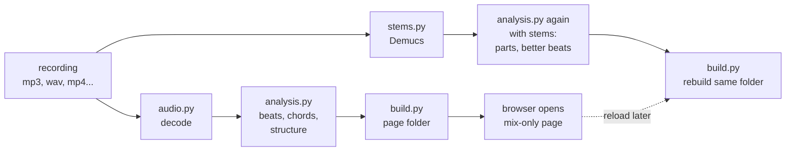
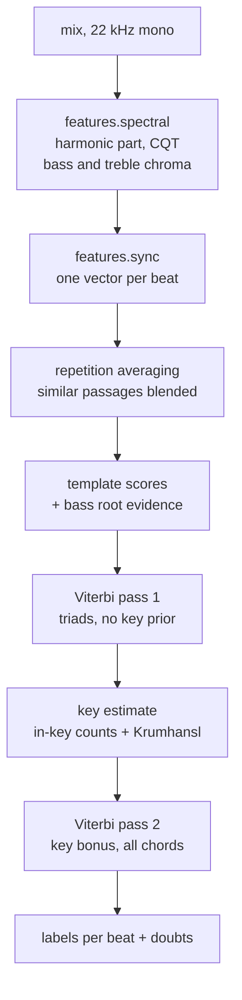
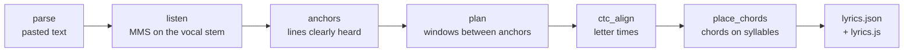
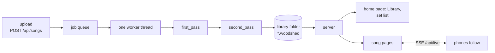

# Under the hood

How woodshed turns one recording into a practice page, and what runs when you open the library.

This is for musicians who code, and for anyone who wants to contribute. Every claim points at a module you can open. Paths are relative to the repository root.

Everything lives in one Python package, `src/woodshed/`, plus the page it ships in `src/woodshed/page/`.

## The models at a glance

No language model and nothing in the cloud: a chatbot cannot hear a recording. woodshed chains small
specialised tools, all running on your computer, on the CPU.

| Step | Tool | Kind |
|---|---|---|
| Split the instruments | [Demucs](https://github.com/facebookresearch/demucs) (htdemucs, Meta) | neural network |
| Beats and downbeats | [beat_this](https://github.com/CPJKU/beat_this) (JKU Linz); without the stems extra, librosa's beat tracker | neural network (beat_this), signal processing (librosa) |
| Chords and key | woodshed's own engine | signal processing, no trained model |
| Bass notes, vocal range | pYIN in [librosa](https://librosa.org/) | pitch tracking algorithm |
| Words on the voice | [MMS forced aligner](https://pytorch.org/audio/stable/pipelines.html#torchaudio.pipelines.MMS_FA) (Meta) | speech model, aligns the text you give it |

The sections below follow a recording through each of them.

---

## 1. The big picture

One recording goes in. One folder comes out: `Song Name.woodshed/`. You can open its `index.html` from disk, offline, with no server.

The work happens in two passes, driven by `src/woodshed/run.py`:

- **First pass** (`first_pass`): analyse the mix only, build a full page, open it. It carries a banner that says the instrument tracks are coming.
- **Second pass** (`second_pass`): separate the instruments, analyse again with the stems, rebuild the page in place.

If the stems are already in the cache, or you passed `--no-stems`, or the stems extra is not installed, there is only one pass.



What makes this safe to repeat:

- `run.py` writes a manifest, `woodshed.json`, in each page folder. It holds the settings the page was built from, a summary, and a `complete` flag.
- `up_to_date()` skips the work when the manifest matches, `complete` is true, and `index.html` and `audio/mix.flac` still exist.
- The settings include the woodshed version, the analysis revision (`REVISION` in `src/woodshed/analysis.py`), the page revision (see section 9), the file's content hash, and your options (`--title`, `--bpm`, `--sevenths`, beats per bar).
- If the second pass fails, the page keeps the mix and loses its banner. The error still goes up.

For a folder of songs, `run_folder` builds every mix-only page first. Then it adds the stems song by song and rewrites the index (`src/woodshed/songbook.py`).

The commands live in `src/woodshed/cli.py`: `woodshed SONG`, and the subcommands `chart`, `cache`, `app`, `lyrics`.

---

## 2. Audio in

`src/woodshed/audio.py` is the only decoder of user files. Stem separation goes through it too.

- **With ffmpeg** (found on the PATH): any format ffmpeg can read, video files included. Decoded to 16-bit PCM, then to float32.
- **Without ffmpeg**: libsndfile through `soundfile`, so WAV, FLAC and Ogg. Resampling is done by librosa.
- The two paths resample differently, so samples can differ slightly. The docstring says so.
- Analysis runs at 22,050 Hz mono (`SR`). Stems and the page's tracks use 44,100 Hz stereo.

Limits, all in `audio.py`:

- Files longer than 30 minutes are refused (`MAX_SECONDS`). When the length cannot be read from the header, decoding stops at 30 minutes instead.
- Decoding times out after 600 seconds.
- ffmpeg is called with a format whitelist and `-protocol_whitelist file,pipe`. A playlist file named `song.mp3` cannot make it read other local files.

### Caches

`src/woodshed/cache.py` picks the folder: `WOODSHED_CACHE`, else the platform cache folder (`LOCALAPPDATA`, `~/Library/Caches`, or `XDG_CACHE_HOME`).

Under it, `src/woodshed/stems.py` keeps one folder per recording and model: `stems/htdemucs-<hash>`. The hash is the first 20 hex characters of the SHA-256 of the file's bytes. Rename or move the file and the cache still hits. Edit the audio and it misses.

The lyrics step stores its speech-model output in the same folder (section 8).

---

## 3. Separation

`src/woodshed/stems.py` runs Demucs, model `htdemucs`, on the CPU. It needs the stems extra.

- Four stems: `drums`, `bass`, `other` (guitars and keys), `vocals`.
- Stored as **24-bit FLAC**, lossless. The comment says why: the stems are what you hear, so quality is not traded for space.
- Demucs output can exceed full scale. One common gain is applied to all four stems so nothing clips and they still add up. The gain goes in `gain.json` and is undone at playback.
- The cache entry is written to a private temp folder and renamed in one step. An interrupted run never leaves a half-written entry.
- A cache entry is only served when all four files and a readable `gain.json` exist.

Time: `SEPARATION_SPEED = 1.5` in `run.py` is the measured CPU cost, seconds of work per second of audio (on one laptop, one song). It feeds the "about N min" message and the page banner.

`src/woodshed/models.py` guards model downloads. With `--offline`, nothing is fetched and a missing model is a clear error.

`src/woodshed/tracks.py` then writes the page's audio, all 24-bit FLAC:

- `mix`
- `minus-drums`, `minus-bass`, `minus-other`, `minus-vocals`: the mix with one stem subtracted
- `solo-drums`, `solo-bass`, `solo-other`, `solo-vocals`

The tracks are written block by block (10 seconds at a time), because nine stereo tracks would not fit comfortably in memory. One gain is shared across all of them, so switching tracks never changes the level.

---

## 4. Beats and bars

`src/woodshed/beats.py` has two trackers:

- **beat_this** (stems extra): gives beats and downbeats. Run on the decoded source, re-encoded to a clean WAV first, because its own loader rejects some valid files.
- **librosa** (core install): beats only. It adds back beats it missed before the first detection.

Either way, fewer than 4 beats is an error ("is this music?").

Then two questions need an answer: which beats are the "real" ones (tempo octave), and which beat is beat one of the bar (phase). That is `resolve_meter` in `src/woodshed/analysis.py`, with helpers in `src/woodshed/meter.py`.

**Tempo octave**

- With `--bpm`: `fit_octave` keeps, halves or doubles the grid, whichever lands nearest the tempo you gave. When halving, it keeps the more accented beat parity.
- Without `--bpm`, with librosa only: `tempo_octave_parity` (in `meter.py`) looks at a tempo of 125 BPM or more, with at least 8 chord changes. It halves only when two cues agree: chord changes sit almost all (80%) on one beat parity, and that parity is clearly more accented than the other.
- beat_this is not checked for doubling. The comment in `resolve_meter` says it does not double the tempo.

**Bar phase**

- With downbeats: `phase_from_downbeats` takes the beat position holding the most downbeats. It is used if that share is at least 50% (`MIN_DOWNBEAT_SHARE`).
- Otherwise the decoder estimates the phase from where chord changes fall, and `pick_phase` breaks ties by onset accent.
- Every correction ends in a fresh decoding. Chords, doubts and bar lines all come from the same grid and phase.

---

## 5. Chords

The chord engine is written in this repository. It is in `src/woodshed/engine/`, with the final assembly in `src/woodshed/analysis.py`. It uses librosa and numpy: classic signal processing, no trained chord model.

What that gives:

- It runs in the core install, without PyTorch: `uv sync` without the stems extra is enough for chords, structure and the page (`CONTRIBUTING.md`).
- Every threshold carries the measurement that set it, in a comment (for example `MIN_CLARITY`, `SILENCE_DBFS`, `MIN_ACCENT_RATIO`).
- When it is unsure, it can say so with numbers: the doubts below come straight from its scores.



### Features

`src/woodshed/engine/features.py`:

- The input is the **full mix**, even when stems exist. Stems are used for beats, vocal activity and the instrument parts, not for chords.
- Harmonic part first (`librosa.effects.harmonic`), then tuning estimation, then a constant-Q transform from C1 over 7 octaves.
- Two chroma vectors: **bass** (C1 to B2) and **treble** (C3 to B7).
- Beat-synchronous: the median of each chroma over each beat.
- The expensive spectral step does not depend on the beat grid. It is computed once and re-synchronised when the grid changes (`spectral` then `sync`).
- Per beat it also keeps the energy, and an absolute level used to judge silence.

### Templates and scores

`src/woodshed/engine/decoding.py`:

- Chord vocabulary: 12 roots with major and minor triads. `--sevenths` adds `7` and `m7`, with the seventh weighted 0.6 and a small penalty so a seventh must beat its triad.
- Each chord is a unit-norm chroma template. The score is the cosine fit to the treble chroma, plus `bass_weight` (0.2) times root evidence from the bass.
- The bass term is weighted by how clear the bass is on that beat. A flat profile (kick drum, noise) barely counts.

### Repetition averaging

`smooth_repeats`: each beat is blended with the most similar beats elsewhere in the song. Similarity is cosine distance over four-beat fragments, so bars are compared, not single beats. Four neighbours (`repeat_k`), 60% mix (`repeat_mix`). The idea is that the third chorus helps the first one.

### Key prior

- A first Viterbi pass uses triads only and no key prior. The comment says the key and phase must not depend on the chosen chord vocabulary.
- `estimate_key` picks the major key whose diatonic chords cover the most decoded chords. Krumhansl-Kessler profiles then choose between that major and its relative minor.
- A small bonus (`key_bonus`, 0.03) goes to in-key chords for the second pass.

### Bar-aware Viterbi

`viterbi` takes a different "stay" probability per beat. `change_probs` sets the chance of a chord change by position in the bar:

- 0.5 on beat one
- 0.10 at the half bar (even meters)
- 0.02 anywhere else

So the decoder prefers chords that change on bar lines. A "no chord" state is forced on silent beats and forbidden elsewhere. Silence is judged on absolute level in dBFS, so a quiet verse is not silence.

`clarity` is the median fit of the best triad on voiced beats. Under `MIN_CLARITY` (0.56) the page is flagged as unreliable. The comment lists what was measured: music 0.60 to 0.74, drums alone 0.58, noise about 0.53, a solo voice 0.49. It is a warning only, "the margin is thin".

### Doubts: "spots to check by ear"

A chord is marked doubtful (`doubtful_beats`) when it lasts a single beat, or starts off the bar line and half bar (unless it follows silence).

Then `src/woodshed/structure.py` scores it:

- Take the mean score of the chord over its beats. Keep the top three candidates.
- Turn scores into shares with a softmax. The contrast is `SHARPNESS = 25.0`, defined in `src/woodshed/model.py`. The decoder uses the same value, so the shares match its odds.
- If the top candidate has under 70% (`CLOSE_CALL`), the doubt is `kind: "chord"`. It is counted and shown in orange.
- Otherwise it is `kind: "timing"`: the chord is clear but its placement is odd. Not counted.

The chart's chord comes from the whole song (the bars around it, the key, the same part played again); the shares come from the bar heard alone. When they disagree, the page says so ("the chart keeps A: the bars around it point to it; heard alone, this bar sounds more like C♯m"), and the analysis's chord is always in the list, so a correction can be changed or taken back. The page shows the candidates with their shares. You can play each one over the recording and pick. Corrections stay with the page (section 9) and go into the exports.

---

## 6. Structure

`src/woodshed/structure.py` builds bars from the labels and groups them into **lines of four bars**. Identical consecutive lines collapse into one line with a repeat count, except across a section start.

Lettering (`_Lettering`): a line that differs from a known line by a single bar keeps that letter with a prime (`A′`, `A″`). Any other new line gets the next letter. Variants need at least 3 bars.

Section names come from `src/woodshed/sections.py`. The module's docstring calls it a guess made from what can be measured:

- Lines that play the same chords in the same order are one family.
- A lone line close to a neighbour in chords and loudness joins that neighbour.
- Blocks that sound alike share a letter.
- Among letters heard more than once, the loudest is the chorus and the first heard is the verse. A part always heard right before the chorus is the pre-chorus.
- A part heard once is the intro (first), the outro (last), or a bridge when it is the only one.
- With the vocal track, `sung` (share of beats with a voice) helps tell instrumental parts from verses.

Names are numbered (`Verse 1`, `Chorus 2`). When nothing fits, parts are only lettered.

**Naming by the words.** If you place lyrics (section 8), `sections_by_words` in `src/woodshed/lyrics.py` names the sections again. The words say more than the chords do:

- The same lines are the same part, even if a chorus was read with different chords the first time.
- A part sung each time just before the chorus is the pre-chorus.
- The end of a stanza stays with its verse.

It returns `None` when the words agree with the chart's names. Names that do not fit the chart (order, overlap, bar range) are ignored (`fitting_sections`).

`harmony_summary` in `structure.py` adds roman numerals and a progression name per section.

---

## 7. Instrument parts

With stems, `analysis._parts` reads each stem on a **sixteenth-note grid** (`Grid` in `src/woodshed/parts.py`). First `drum_grid_shift` measures the median lag between strong drum hits and the beat grid and shifts the grid by it, since trackers often lag by tens of milliseconds.

| Part | Source stem | How (`parts.py`) |
|---|---|---|
| Bass line | `bass` | `librosa.pyin` (30 to 300 Hz). A note is kept on a sixteenth only if an onset falls there. Pitch is the median of the voiced frames, with a confidence. |
| Drum groove | `drums` | Energy rise in bands: kick 30 to 110 Hz, snare body 180 to 600 Hz plus wires 7 to 11 kHz, hat in the highs. Gives the share of bars with a hit per slot, and how well each bar agrees with the main groove. |
| Comping rhythm | `other` | Onset peaks per sixteenth, as a share of bars. |
| Keys voicings | `other` | Chroma per bar, up to four pitch classes above a threshold, strongest first. |
| Vocal range | `vocals` | `librosa.pyin` (80 to 1400 Hz), note by note. Reports the 10th and 90th percentile of sung notes: the usual range, not the extremes. |

All thresholds carry their measurements in comments. The bass tab and the drum groove are marked experimental in the page (README).

`vocal_activity` in the same module gives the share of each beat where someone sings. Structure uses it.

**Guitar shapes.** `src/woodshed/shapes.json` holds open shapes and two easy barres. It is the single source for the page's chord diagrams and for capo difficulty in `src/woodshed/theory.py` (`suggest_capo`). `src/woodshed/view.py` ships the shapes to the page.

`theory.py` also does spelling (sharps or flats by key), roman numerals and named progressions. The page holds no theory. `view.py` precomputes, for all 12 transpositions, the key name, the capo and the spelling of each root. The page only looks names up.

---

## 8. Lyrics

You paste the words. woodshed does not invent them. It only finds when each word is sung.

Two ways in, one function behind them (`add_to_page` in `src/woodshed/lyrics.py`), which reports how far it is (each 30-second window of the voice heard is a step; the page shows a progress bar):

- In the library app, **Add the words** on a song page (`page/assets/js/views/words.js`) sends them to `POST /api/lyrics`. The placement is a job of the library queue (section 11), and the page reloads with the words when it is done. Opened from disk, the page has no app behind it: the dialog gives the command instead.
- On the command line:

```bash
woodshed lyrics "Song.woodshed" words.txt
```

It needs the stems extra and an already-built page with stems in the cache. The flow, as numbered in the file's docstring:



**Parse.** `parse` reads the pasted text:

- Parts start at a blank line or a part name (`[Chorus]`, `Refrain x2`, `Couplet 2 :`, English or French words).
- `x2` repeats a part or a line. A part's name alone (`[Chorus]`) repeats the last part of that name; a chorus named nowhere before is the stanza written out most often (at least twice, then `[Chorus]` on lyrics sites), and when two stanzas come back as often nothing is guessed. A name with no words to repeat (`[Solo]`, `[Bridge]`) names the music between the lines around it, and a sung part's name with nothing to repeat is reported to the user.
- Rows of chords and `[Am]` chords inside words are dropped. The chart has the chords.
- Words in brackets are backing vocals, kept apart.
- The model hears only `a` to `z` and the apostrophe. Accents are stripped. Other letters raise an error ("write numbers out as words" in the README).

**Listen.** `listen` runs the MMS forced aligner (`torchaudio.pipelines.MMS_FA`, with a star token) on the vocal stem:

- Resampled to 16 kHz, run in **30-second windows**, because attention over a whole song would need gigabytes.
- `windows` adds 80 samples to each window so it yields exactly 1500 frames. Frame `f` is then at `f x 20 ms` all through the song. Without that, words would drift 20 ms early per 30 seconds.
- The output is log-probabilities per 20 ms frame, for each letter plus a wildcard. It is cached as `mms_fa-2.npz` next to the stems.
- A voice mask marks where the vocal stem is silent, so no letter can be sung in a solo.

**Anchors and chaining.** `anchors` finds sung phrases and decodes what the model heard. A phrase is an anchor if it matches 1 to 3 consecutive text lines with a letter error rate of 0.45 or less (`ANCHOR_CER`), over at least 15 heard letters. `_chain` keeps the best chain that goes forward in both text and time. Lead voices are heard well. A chorus with backing vocals and held vowels is not, so choruses are rarely anchors.

**Plan.** `plan` places the lines between anchors. It leaves out lines that cannot fit: lines sung once that the model did not hear (a verse cut from this version), and lines that do not fit the singing time (an excerpt). Each left-out line gets a reason.

**CTC alignment.** `ctc_align` is a CTC Viterbi path written in numpy. Each run of lines is aligned exactly inside its window, with a wildcard between lines for backing vocals and ad-libs. Every letter gets a start and an end.

**Chords on words.** `place_chords` puts each chord change on the syllable sung then. If the next word starts within a short push (at most 0.2 s, half a beat at most) after the change, it takes that word. Otherwise it takes the word still sung or held, up to half a bar. Otherwise it sits in a gap.

**Checks.** Every line carries a `check` field when the placement is not certain:

- placed by the order of the text, not anchored
- squeezed: sung in too little time to hold the words
- not heard, or no room left, or could not be placed

The page shows these lines as "to check". A line the model could not place is marked, not faked.

**Output.** `lyrics.json` in the page folder (version 1), and `lyrics.js` with the same data, so the page can read it from disk. Rebuilding a page keeps the words (`_keep_lyrics` in `build.py`). Times are kept and chords are placed again on the new analysis. If the source recording changed, only the text is kept, as `lyrics.previous.json`.

**Licence.** The MMS weights (about 1.2 GB) are **CC BY-NC 4.0**: non-commercial use. woodshed itself is MIT. The README lists the licence of every model, and the `lyrics` command prints a notice.

---

## 9. The page folder

What `src/woodshed/build.py` writes:

```
Song Name.woodshed/
  index.html          the page, song data embedded as JSON
  lyrics.js           the words, or an empty stub
  lyrics.json         only when words were placed
  woodshed.json       the manifest (section 1)
  assets/             scripts, styles, fonts, samples, VexFlow
  audio/              mix.flac and, with stems, minus-* and solo-* FLAC files
  exports/            .cho, .lab, .json, .mid, .musicxml
```

### How it is built

- Assembled in a temp folder next to the target, then renamed in one step. An interrupted build never leaves a half page. On Windows a page open in a browser can block the rename, and the error says so.
- `index.html` comes from `page/template.html` and `page/body.html`. Song data goes into a `<script type="application/json" id="woodshed-data">` element. `script_json` escapes `<`, `>`, `&` and the line separators so a title cannot close the element.
- The data has two blocks. `song` follows `src/woodshed/song.schema.json` (written by `src/woodshed/song.py`, `SCHEMA_VERSION = 2`). `view` follows `src/woodshed/view.schema.json` (display tables and the track list from `view.py`).
- The model in `src/woodshed/model.py` is plain data with no audio library, so exporters and the songbook do not load librosa.

### Page revision

`page_revision()` hashes every shipped file under `page/` (names and bytes) and keeps 16 hex characters. It goes into the manifest. If the page code changes, even without a version bump (an update from git), the page gets the new code without a new analysis: `refresh_code` writes `index.html` again from the data it carries and replaces `assets/`, and `woodshed app` does it for every page when it starts. Only data of another format (`SCHEMA_VERSION`, `VIEW_VERSION`, pinned by a test against the schemas) needs a rebuild.

### Strict CSP and no network

`template.html` sets a Content-Security-Policy:

- `default-src 'self'`, `script-src 'self'`: no inline scripts, no external scripts.
- `connect-src 'self'`, `object-src 'none'`, `base-uri 'none'`, `form-action 'none'`.
- `img-src 'self' data:`, `media-src 'self'`, `font-src 'self'`.
- `style-src 'self' 'unsafe-inline'`.

There is no CDN and no font host. Fonts, samples and VexFlow are vendored under `page/assets/`, pinned by hash in `scripts/vendored.sha256`. `tests/test_page_sources.py` forbids `innerHTML`, `eval` and `document.write` in the page code. Song data reaches the DOM only as text.

### Scripts and the store

No bundler and no modules. The page uses classic `<script>` tags that all add to one global, `window.Woodshed` (`page/assets/js/core/woodshed.js`, which also holds the small `h()` DOM helper).

The load order is fixed in `template.html`, and a test checks that every script is loaded in dependency order:

- `core/`: `prefs.js` (theme and language, in `<head>`), `woodshed.js`, `i18n.js`, `i18n-fr.js`, `song.js`, `lyrics.js`, `state.js`, `instruments.js`, `exports.js`
- `audio/`: `sounds.js`, `transport.js`
- `views/`: `header.js`, `chart.js`, `desk.js`, `dock.js`, `band.js`, `words.js` (the words dialog)
- `app.js` last, to wire it together

`core/state.js` is the store, and it is small: a frozen state object, `set(patch)` merges and tells listeners which keys changed, `on(fn)` subscribes. Views read from it and subscribe. Nothing else holds state.

### English or French, dark or light

`core/prefs.js` runs in `<head>`, before the page is drawn: it sets the theme (`data-theme`, dark unless light was chosen) and the language (`<html lang>`, the browser's at first, English or French), both kept in the browser's storage.

- Every sentence of the page's own goes through `W.t` (`core/i18n.js`): the English text is the key, `{names}` are filled in, and `core/i18n-fr.js` holds the French. The fixed text of `body.html` and `home.html` is translated by `W.translatePage`.
- The song's own text (title, chord names, roman numerals, words) is never translated, and is marked `translate="no"` so a browser's translator leaves it alone too. The names the analysis gives the parts ("Verse 2", "Part B") are translated for display (`W.partName`), also when the words named them (their tags set the role, the name is the analysis's).
- Switching language redraws every view from the store: the music goes on.
- `tests/test_page_sources.py` fails on any text of the page code or of the HTML without its French; `tests/page/test_french.py` opens every menu, panel and stage mode in French and fails on any text of the dictionary left in English. Python's texts shown by the page (doubt reasons, progressions, track labels) are checked too.

### Following the song

While the song plays, `keepInView` (`views/chart.js`) scrolls the page so the bar or the sung line playing stays in the upper part of the screen, above the dock. A scroll by hand (wheel, touch, scroll keys, the scrollbar) wins for four seconds; the page's own keys (a pedal's Page Down) do not count as one. It does not move a page whose chart is off screen (a phone reading the instrument panel under it), nor in stage mode.

### Audio playback and time-stretch

`audio/transport.js` plays the real recording, not a synthesis.

- One `<audio>` element per track. Only one plays at a time, so instruments never drift apart. Switching "full mix" to "without bass" swaps the element at the same position.
- Speed changes use the browser's own time-stretch: `playbackRate` with `preservesPitch`. woodshed has no stretching code of its own.
- Loops are checked on `timeupdate` too, because throttled tabs run no animation frames.

### Samples and notation

- `audio/sounds.js` plays previews (a chord shape, a bass riff, the groove, a candidate chord, the count-in) with the Web Audio API. Samples come from the FluidR3 GM SoundFont (MIT), in `page/assets/samples/samples-<instrument>.js`, loaded on first use per instrument. Only the notes needed are decoded.
- Drum notation is drawn by VexFlow 4.2.2 with the Bravura font (`page/assets/vendor/`). `app.js` loads it on first use. If it fails, the hit grid shows the same groove.

### Corrections

Your chord picks are saved in the browser's `localStorage` (`app.js`). When the page is served by the library app, they are also sent to a shared store (section 11).

---

## 10. Exports

From the page's Export menu, and written into `exports/` at build time:

| Format | File | Notes |
|---|---|---|
| ChordPro | `.cho` | With the words and parts when lyrics are placed. For OnSong, SongbookPro. |
| MIDI | `.mid` | Type 1, 480 ticks per beat. Chords, bass line, drums on the beat grid. |
| MusicXML | `.musicxml` | Chord symbols over the bars, and the bass line. For MuseScore. |
| Chord timeline | `.lab` | MIREX style. |
| JSON | `.json` | The song data. |

`src/woodshed/exports.py` reads the **published song JSON**, not the analysis objects. That is why a page can export its own data, including your corrections, the same way. `src/woodshed/songbook.py` writes the index page for a folder of songs.

### The parity rule

The same exports exist twice: in Python (`exports.py`) and in the browser (`page/assets/js/core/exports.js`). The page needs them in the browser to apply your corrections without a server.

The rule: **for an uncorrected song, the two produce the same bytes.** The JS file says so in its header ("a test compares them"). The page tests download the MIDI from a real browser and compare it with `exports.midi(data)` (`tests/page/test_page.py`).

The same idea applies to placing chords on words: `core/lyrics.js` uses the same rule as `lyrics.chord_changes` and `lyrics.place_chords` in Python.

If you change an export, change both sides in the same commit.

---

## 11. The library app

`woodshed app [LIBRARY]` is `src/woodshed/app.py`. It is a small HTTP server using only the standard library (`ThreadingHTTPServer`). It lists your page folders, serves them, and turns uploaded files into new pages. The page folders are the same as those the command line makes.



### Library and jobs

- A library is a folder. Uploads land in `songs/`. Each song gets a page folder next to it.
- The home page lists pages by reading their `woodshed.json` manifests.
- `Library.add` puts a job on a queue. **One worker thread** takes one job at a time, so only one analysis runs at once. It runs the same `first_pass` and `second_pass` as the command line.
- A job goes through `queued`, `analysing`, `separating`, `done` or `failed`. The home page polls its progress.
- Words pasted on a song page are a job of the same queue (`kind: "words"`, status `placing`): one heavy job at a time, and never two jobs on one song at once. They are allowed from the computer that runs the app, like uploads, and are 32 KB at most. A words job is not resumed after a stop: paste them again.
- If the app stops during a job, that job is not marked failed. It is resumed at next start (`resume`).
- Uploads are limited to 2 GB and need free disk space for the tracks.
- The **set list** is `setlist.json` in the library: the order the band plays songs in.

### Security model

The module docstring states the idea: the server answers any page the browser opens, so it trusts nothing it did not give out itself.

- Binds `127.0.0.1` by default. Another `--host` needs `--allow-network`.
- **Host check** (`_host_ok`): a request whose `Host` header is not one of this computer's names is refused. That stops DNS rebinding, where a hostile site's name suddenly points at your machine.
- **Token**: a random token per run. Every POST needs it in the `X-Woodshed-Token` header. A cross-site form or fetch cannot send a custom header, and preflight requests (OPTIONS) are refused.
- The live stream passes the token in the query string (browsers' `EventSource` sends no headers), and also checks `Sec-Fetch-Site`.
- Uploads are allowed from this computer only, unless `--uploads-from-network`.
- Static files come from the library folder or the shipped page assets (`/app/`), never from outside them; hidden files such as `.corrections/` are refused.

### Band mode

One device leads, others follow. It is built on `Live` in `app.py` and `page/assets/js/views/band.js`.

- The leader posts its song, position, speed, loop and play state to `POST /api/live`.
- Followers open `GET /api/live`, a **Server-Sent Events** stream. Each event carries the leader's state and the server clock, so a follower can measure its offset.
- Server state is in memory. One leader at a time: a device that claims the lead takes it, and updates from a non-leader are refused.
- Limits: 32 open streams, 4 KB per update, a keep-alive ping every 15 seconds.

### Shared corrections

Chord picks are also stored on the server so a phone and a laptop see the same chart.

- One file per page in `.corrections/` inside the library. Never served.
- Keyed by an analysis key, so a re-analysis does not inherit picks for doubts that no longer exist. The last 8 analyses are kept.
- Two devices writing at once: both sets of picks are merged, and the later choice for the same doubt wins.
- A revision number grows with each change. Followers hear it through the live stream and read the chart again.

### Docker

The `Dockerfile` sets `WOODSHED_CONTAINER=1` and `WOODSHED_CACHE=/cache`, and runs `woodshed app /library --host 0.0.0.0 --allow-network --uploads-from-network --no-open --port 8000`.

- `WOODSHED_CONTAINER`: inside a container, the app's own address is on Docker's bridge, so phones cannot use it. The app then shows no LAN addresses (`in_container`).
- `WOODSHED_PUBLIC_URL`: a comma-separated list of the addresses the phones should type (for example `http://192.168.1.20:8000`). Used when the app cannot know them. Each URL is checked against a pattern.
- Uploads must be allowed from the network inside a container, because every request comes through the bridge. Publish the port as `127.0.0.1:8000:8000` to keep it to your computer.

---

## 12. Testing and CI

### What is tested, and how

- **Synthetic songs** (`tests/synth.py`): deterministic songs rendered from a spec (tempo, meter, chords, bass, hats), with exact ground truth for chords, beats, downbeats and stems. Engine tests run on these, so they stay short and cheap, and the right answer is known.
- **Engine golden file** (`tests/golden/engine.json`, regenerated with `tests/golden/regenerate.py`): exact labels per librosa and numpy version, plus a fixed "reference" entry that every environment must match in accuracy.
- **Unit tests**: one `tests/test_*.py` per module (audio, beats, meter, engine, structure, sections, parts, lyrics, exports, build, app, band, check_repo).
- **Page tests** (`tests/page/`, marker `page`): Playwright opens built pages from `file://` in **Chromium and Firefox**. Any network request, console error or console warning fails the test.
- **Parity tests**: the page's MIDI is compared with the Python one byte for byte (section 10). Lyrics placement is compared the same way.
- **Static page rules** (`tests/test_page_sources.py`): no markup from strings, every script loaded in order.
- **Real stems** (`tests/test_stems_real.py`, marker `stems`): the real Demucs and beat_this, which download models.

### The repo guard

`scripts/check_repo.py` is a hygiene check that runs on tracked files. It rejects:

- audio and video files (the demo song is the one exception, with its licence next to it and pinned by hash)
- files over 1 MB, outside vendored folders
- home-folder paths and secret-looking strings
- network URLs in the page's own code
- vendored files whose hash changed without review
- a font without its own licence file

`scripts/check_wheel.py` checks that the built wheel ships exactly what git tracks under `src/woodshed`.

### Workflows

In `.github/workflows/`:

- `ci.yml`: on push and pull request. Jobs: checks (guard, lock, ruff, mypy, actionlint), tests on Python 3.10 to 3.14 (Ubuntu, plus macOS and Windows on 3.10 and 3.14), the page in Chromium and Firefox, a package build and smoke test, and the stems extra with real models.
- `install.yml`: tries the install scripts on Linux, macOS and Windows, and the Docker image, when those files change.
- `docker.yml`: builds the image on native x86 and ARM machines and publishes one tag for both, from `main` and from version tags.

`scripts/ci.sh` runs a local version. `--full` runs what GitHub runs.

---

## 13. Where to start reading

In this order, each file is short enough to read in one sitting:

1. `src/woodshed/run.py`: the two passes and the manifest.
2. `src/woodshed/analysis.py`: `analyze` is the whole pipeline in one function.
3. `src/woodshed/model.py`: the result, as plain data.
4. `src/woodshed/engine/decoding.py`: how chords are decided.
5. `src/woodshed/structure.py` and `src/woodshed/sections.py`: bars, lines, sections.
6. `src/woodshed/parts.py`: the instrument parts.
7. `src/woodshed/lyrics.py`: the long one. Read its docstring first.
8. `src/woodshed/build.py` and `src/woodshed/page/template.html`: what the page is made of.
9. `src/woodshed/page/assets/js/core/state.js`, then `app.js`: the page.
10. `src/woodshed/app.py`: the library server.
11. `tests/synth.py`: how tests get a song with a known answer.
12. `CONTRIBUTING.md`: the rules the checks enforce, and the ones they cannot.
