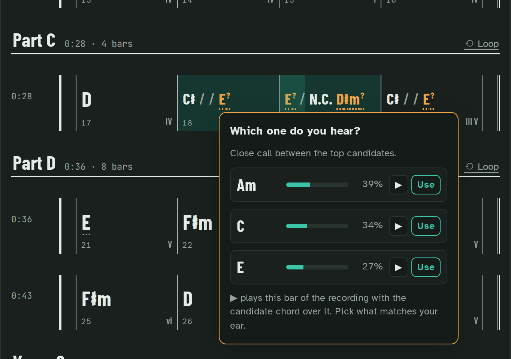
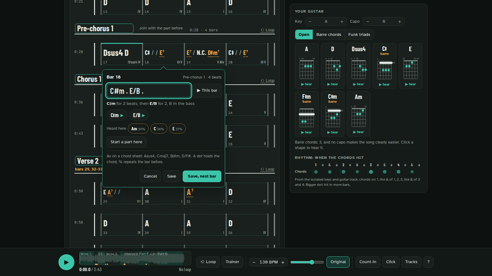
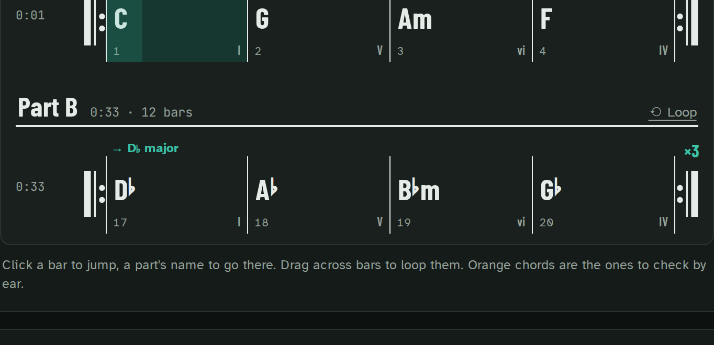

# The chart: check it, fix it

Where the analysis hesitates, woodshed says so instead of guessing quietly. Where it is wrong, you
type the bar as on a chord sheet. Your corrections go into the exports, and through the library
every device of the band sees them.

## Check by ear

The spots to check are marked on the chart: press one, hear each candidate chord played over that
bar of the recording, and keep the one your ear agrees with.

## Edit the chart

**Edit the chart** when the chart is wrong, or right in a vocabulary the analysis does not have.
Click a bar and type its chords as on a chord sheet: `G . Am .` (a dot holds the chord), `D/F#`,
`Asus4`, `Cmaj7`, `Bdim`, `%` for the bar before. woodshed reads it back in words ("D/F♯ for 2
beats, F♯ in the bass, then G for 2"), lets you hear each chord and the bar of the record, and
offers to type it on every repeat of that line.

**Enter** saves the bar; **Ctrl+Enter** (**⌘+Enter** on a Mac) saves and opens the next one.

With the words placed, the button reads **Edit chords and words** and the words stay on screen: a
chord name or a bar number opens that bar, a line opens the line editor to fix its words (see
[For singers](singers.md#fix-a-line-on-the-sheet)). With the keyboard, the lines are one Tab stop:
the arrows go from line to line, **Enter** opens the line, **Escape** comes back to it, and Space
still plays.

A line too long for one row, or two short lines sung as one phrase: in the line editor,
**Shift+Enter** (or **Split at the cursor**, behind **More** on a phone while the keyboard is up)
breaks the line where the cursor is, up to four rows, and **Save** places them together in the
line's own time. **Join with the next line** makes the line and the next one of the same part a
single line, placed in the time of both; in Edit mode the line it took in shows as a quiet row,
"joined into line 7", with **Back to the placement**. Undo and **Back to the placement** take back
the whole split or join, and the songbook file in the page folder (`exports/*.cho`) is written again
with the fixes.

Through the library, the bar editor also offers **+ Type a line here**: a line of the words typed
from that bar, `|` before the word on beat one of the next bar (see
[For singers](singers.md#type-a-line-yourself)). It is how a song with no words gets its first line.

Shapes, keys, the stage view and every export follow what you type, and through the library the
band's phones get it live.

## Parts: rename, join, start

Rename the parts as your band calls them, join two, or start one on any bar.

## Bar lines one beat off

Bar lines one beat off? **Bar lines…** asks where beat one is, and the library analyses the song
again from its tracks with the bars there, your typed chords staying on their beats (from disk:
`woodshed "song.mp3" --bar-phase 1`).

## Back to the analysis

Each typed bar or part can go back to the analysis, or the whole chart at once (with an undo), on
every device of the band.

## Key changes

A last chorus lifted a semitone, a bridge in another key: woodshed finds where the key changes and
marks the bar ("→ D♭ major", with a double bar line). From there the numerals read in the new key
(I V vi IV again, not bII), the chords are spelled in it (G♭, not F♯), and a chord it hesitates on
is weighted toward it. The header says "C major → D♭ major".

On stage, a change inside a part is announced two bars ahead ("Key change in 2 bars: D♭ major", then
"next bar"), and one where a part starts rides on the part line ("Part B next bar · in D♭ major");
the top line always says the bar's key. While a bar in another key plays, each panel's title says
"now in D♭ major"; the guitar's shapes come by key ("From bar 17: D♭ major"), with a word for the
hands on a lift; the voice panel says "Up a semitone at bar 17" before you pick a key; the chart's
key note lists where the key moves; where the chords around the change are unsure, the mark says
"check by ear".

The words show the change above their line, the library and the set list say the key a song ends
in, and the ChordPro and MusicXML exports change key where the song does.

A change counts when the new key holds at least 8 bars and its own tonic takes over: a bridge on the
relative minor, a rock vamp on bVII or a few borrowed chords stay in the song's key. Shorter changes
(a tonicisation) are not found, and the band cannot type one yet.
