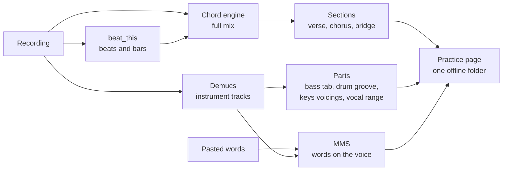

# How it works

What woodshed does with your recording, how sure it is, and the licences of what it uses.

## Why woodshed

You have a recording and a rehearsal on Thursday. Chord sites give you a guess with the wrong
voicings, no bar lines and nothing for the bassist or the drummer. Transcribing by ear takes an
evening per song.

woodshed listens to the recording itself. It splits it into instrument tracks, finds the beats,
the bars, the chords and the sections, writes out the bass line and the drum groove, and places the
lyrics on the singer's voice. Then it gives every musician in the band their own way into the song.

## The analysis

- **Separation**: [Demucs](https://github.com/facebookresearch/demucs) (htdemucs_6s) splits the mix
  into vocals, drums, bass, guitar, piano and the rest, losslessly cached.
- **Beats and bars**: [beat_this](https://github.com/CPJKU/beat_this) finds beats and downbeats.
- **Chords**: woodshed's own engine (signal processing, no trained model) reads the harmony from the
  full mix, bar by bar, and says where it is unsure rather than guessing.
- **Structure**: lines that come back are grouped into sections and named by their role.
- **Lyrics**: Meta's [MMS](https://pytorch.org/audio/stable/pipelines.html#torchaudio.pipelines.MMS_FA)
  aligns the words you paste on the vocal track.
- **The recording in another key**: the Rubber Band library, through ffmpeg's filter or the Rubber
  Band program (see [the recording in your key](singers.md#the-recording-in-your-key)).
- **The page** is plain HTML, CSS and JavaScript in one folder. It loads nothing from the internet:
  the repository's CI rejects any page code that points outside. Opened from disk, it makes no
  request at all; the band features talk only to your own library server.

No language model and no cloud service: everything above runs on your computer. The full tour, module
by module, for developers: **[Under the hood](../architecture.md)**.

## Privacy

Everything runs on your computer: the analysis, the models, the library server (which listens on
this computer only until you let the band's phones in). Your recordings, your corrections and your
lyrics never leave it. There is no account, no subscription, no ad, and woodshed never checks for
updates on its own. The band's corrections, keys and notes are kept by your own library, in its
folder; a page opened from disk keeps its corrections in that browser.

## How accurate it is

As measured on the prototype woodshed grew from (October 2026; no larger benchmark yet):

- On "Let It Be" (the album version, its first 2:55) against the Isophonics reference, chords
  84.5 % right (major/minor), beats and downbeats found at 0.97 (F-measure).
- On a funk cover, the drum groove's kick and snare matched 9 bars out of 10.
- The bass notes' octave was checked on the separated tracks of real recordings.

These recordings and references are copyrighted, so they are not in the repository. The bass tab
note by note is not measured yet: it is marked experimental in the page, as the drum groove, and
both say when the read is unsure ("no clear groove", "no bass heard in this bar"). Check them by
ear. How sure each part is: [your part](parts.md).

## Limits

- Chords are triads by default; `--sevenths` adds 7 and m7 chords, less reliably.
- Key changes: found when the new key holds 8 bars or more; shorter ones (a tonicisation) are not, and the
  band cannot type one yet. One meter for the whole song.
- Lyrics: Latin letters only (most accented letters are fine); write numbers out as words ("twenty", not "20").
- The page is tested in Chromium and Firefox on every change, and what tablets need in WebKit
  (Safari's engine), not yet on a real iPad.

## Models and licences

woodshed is MIT. The models it downloads come with their own licences:

| Model | Used for | Licence |
|---|---|---|
| Demucs (htdemucs_6s, htdemucs) | Instrument tracks | MIT |
| beat_this | Beats and downbeats | MIT |
| MMS forced aligner (weights, 1.2 GB) | Placing lyrics (optional) | **CC BY-NC 4.0**: non-commercial use |

**If your band is paid to play, leave the words feature aside** unless you are sure your use is
non-commercial: it is the only part that needs the MMS weights, and
[their licence](https://creativecommons.org/licenses/by-nc/4.0/) allows non-commercial use only
(this is not legal advice). Everything else in woodshed is under permissive licences (MIT, and SIL
OFL for the fonts) and free for any use, paid gigs included.

The page ships VexFlow (MIT) for notation, the FluidR3 GM SoundFont (MIT) for instrument sounds,
and Atkinson Hyperlegible, Barlow Condensed, JetBrains Mono, Noto Music and Bravura fonts (SIL OFL).

The recording in another key is rendered by [Rubber Band](https://breakfastquay.com/rubberband/)
(GPL-2.0-or-later, Particular Programs Ltd), always as a separate program, never linked: your ffmpeg's
Rubber Band filter, or the Rubber Band program. On a Mac and on Windows the installers download that
program, the official build from [breakfastquay.com](https://breakfastquay.com/files/releases/), checked
against a pinned checksum, into woodshed's tools folder with its licence (on Windows with libsndfile,
LGPL-2.1, which it uses to read and write sound files). woodshed's package, repository and Docker image do
not contain it.

### Your songs and lyrics

**Your songs and lyrics are yours to handle.** woodshed works on the files you give it, on your
computer. Respect the rights on the recordings and lyrics you use, and don't publish pages of songs
you don't have the rights to.

## Credits

The screenshots show woodshed's analysis of four songs by
[Josh Woodward](https://www.joshwoodward.com/), from the album *The Shade from Our Trees*:
[As I Am](https://www.joshwoodward.com/song/AsIAm),
[Same Boat](https://www.joshwoodward.com/song/SameBoat),
[Beyond the Sky](https://www.joshwoodward.com/song/BeyondTheSky) and
[The Rival Within](https://www.joshwoodward.com/song/TheRivalWithin), licensed under
[CC BY 4.0](https://creativecommons.org/licenses/by/4.0/). The images show woodshed's chords, parts
and excerpts of the lyrics placed on the recordings. The [`demo/`](../../demo/) folder ships "As I Am",
recording and lyrics, unchanged ([details](../../demo/LICENSE.md)). Thank you, Josh, for making your music
free to use.
