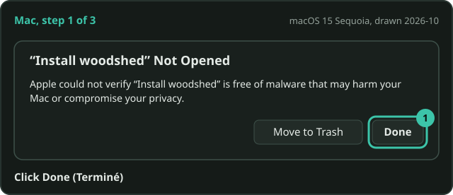
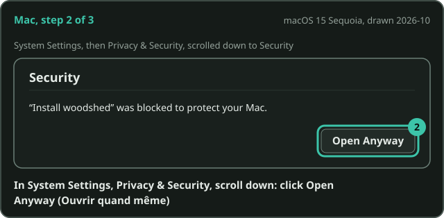
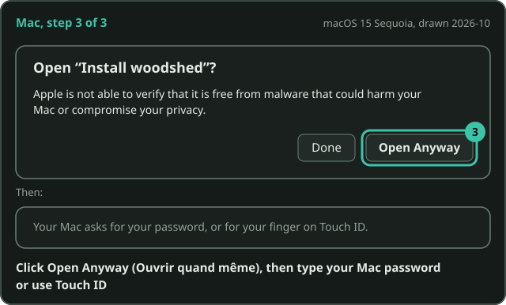
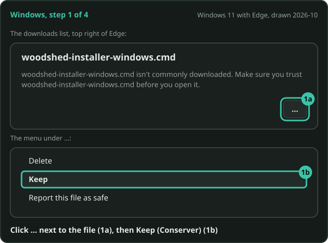
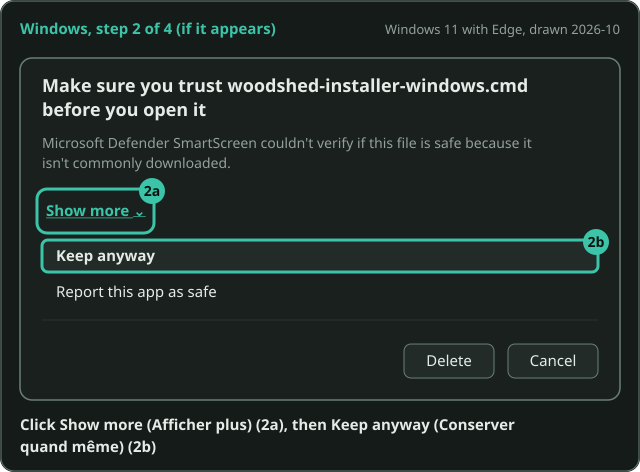
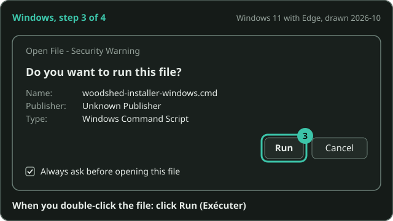
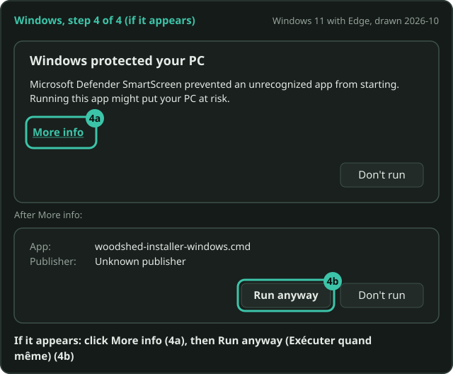

# Install, update, uninstall

No GPU needed, and no Python to install first. On a Mac or a Windows PC, the easiest way is to
download one file and double-click it. On Linux, one line in a terminal does it, and Docker works
everywhere.

What changed in each version is in the [changelog](../../CHANGELOG.md).

- [Download and double-click: Mac and Windows](#download-and-double-click-mac-and-windows)
- [The first time: your computer's warnings](#the-first-time-your-computers-warnings)
- [Intel Macs](#intel-macs)
- [With Docker: Windows, macOS or Linux](#with-docker-windows-macos-or-linux)
- [In a terminal: Linux, macOS or Windows](#in-a-terminal-linux-macos-or-windows)
- [By hand](#by-hand)
- [M4A and video files](#m4a-and-video-files)
- [Try it on the demo song](#try-it-on-the-demo-song) and [the command line](#the-command-line)
- [Updating](#updating) and [uninstalling](#uninstalling)

## Download and double-click: Mac and Windows

For a Mac with Apple silicon (M1 or newer) or a Windows PC. An Intel Mac? See [Intel Macs](#intel-macs).

1. Download the installer for your computer:
   - **Mac**: [woodshed-installer-macos.zip](https://github.com/laugiov/woodshed/releases/latest/download/woodshed-installer-macos.zip).
     Double-click it to get **Install woodshed** (`Install woodshed.command`); Safari may unzip it
     for you, in your Downloads folder.
   - **Windows**: [woodshed-installer-windows.cmd](https://github.com/laugiov/woodshed/releases/latest/download/woodshed-installer-windows.cmd).

   Both come from the [latest release](https://github.com/laugiov/woodshed/releases/latest).
2. Double-click it. A window says what it does, then installs woodshed for you only: about 1.5 GB
   to download, a few minutes, no administrator rights for the install itself. Leave the window
   open until it says **Done**.
3. When it says **Done**, woodshed starts and opens your library in the browser. Drop a song on
   the page and play.

The installers also add the Rubber Band program, which plays the recording in the singer's key
(see [the recording in your key](singers.md#the-recording-in-your-key)): nothing else to install
for it. On Windows they add ffmpeg too when they can (for [M4A and video files](#m4a-and-video-files)).

### The first time: your computer's warnings

The first time you open a downloaded installer (and again after each update, since it is a new
download), your computer warns you about it, because this free project does
not pay Apple or Microsoft to sign it. The warning is about who made the file, not about anything
found in it. Open the steps for your computer: each one says what to click.

<details>
<summary><strong>On a Mac: the first time you open the installer</strong></summary>

macOS cannot check the installer, because this free project does not pay Apple to sign it. You allow it once, in
three steps. What you will see (drawn from macOS 15 Sequoia, 2026-10):

On macOS 14 Sonoma or older, there is a shorter way: right-click the file, choose **Open**, then
**Open** again.

1. A box says "“Install woodshed” Not Opened". Click **Done** (Terminé).

   

   *What you will see (drawn): click Done (Terminé). macOS 15 Sequoia, drawn 2026-10.*

2. Soon after (the button stays about an hour), open **System Settings** (Réglages Système), then **Privacy & Security** (Confidentialité et sécurité). Scroll
   down to "“Install woodshed” was blocked to protect your Mac." and click **Open Anyway** (Ouvrir quand même).

   

   *What you will see (drawn): click Open Anyway (Ouvrir quand même). macOS 15 Sequoia, drawn 2026-10.*

3. A box asks again. Click **Open Anyway** (Ouvrir quand même), then type your Mac password or use Touch ID.
   The installer starts.

   

   *What you will see (drawn): click Open Anyway (Ouvrir quand même), then your password or Touch ID. macOS 15
   Sequoia, drawn 2026-10.*

The words in these boxes vary a little from one macOS version to the next. The **Open Anyway** button in Privacy & Security shows for about an hour after you tried to open the file: if it is
gone, double-click the installer again and start over at step 1. Since macOS 15 Sequoia, right-click then **Open**
no longer skips these steps.

</details>

<details>
<summary><strong>On Windows with Edge: the download and the first run</strong></summary>

Edge and Windows do not know the installer yet, because this free project does not pay Microsoft to sign it. You
allow it once. What you will see (drawn from Windows 11 with Edge, 2026-10):

1. Edge holds the download back: "woodshed-installer-windows.cmd isn't commonly downloaded". Click **…** next to
   the file (Plus d'actions), then **Keep** (Conserver).

   

   *What you will see (drawn): click … (1a), then Keep (Conserver) (1b). Windows 11 with Edge, drawn 2026-10.*

2. If it appears, a box says "Make sure you trust woodshed-installer-windows.cmd before you open it". Click **Show more**
   (Afficher plus), then **Keep anyway** (Conserver quand même).

   

   *What you will see (drawn): click Show more (Afficher plus), then Keep anyway (Conserver quand même). Windows 11
   with Edge, drawn 2026-10.*

3. Double-click the downloaded file. An "Open File - Security Warning" box asks "Do you want to run this file?".
   Click **Run** (Exécuter).

   

   *What you will see (drawn): click Run (Exécuter). Windows 11 with Edge, drawn 2026-10.*

4. If a blue "Windows protected your PC" box appears, click **More info** (Informations complémentaires), then
   **Run anyway** (Exécuter quand même). The installer starts.

   

   *What you will see (drawn): click More info (4a), then Run anyway (Exécuter quand même) (4b). Windows 11 with
   Edge, drawn 2026-10.*

In Chrome, step 1 is a single **Keep** (Conserver) and step 2 does not appear. If nothing works, right-click the
file, choose **Properties**, tick **Unblock**, click **OK** and double-click it again.

</details>

### Next time: starting woodshed

Start woodshed like any other app: **woodshed** in Applications, Launchpad or Spotlight on a Mac,
in the Start menu on Windows. A small window opens next to your browser: keep it open while you
play, close it to stop woodshed (on a Mac, Terminal asks whether to terminate the running
processes: click **Terminate**). Started again while it runs, it just shows the library.

Your songs are in the `woodshed` folder of your home folder.

## Intel Macs

The download is for Macs with Apple silicon (M1 or newer): one part of woodshed has no ready-made
build for Intel Macs, and the installer says so and stops. On an Intel Mac, use
[Docker](#with-docker-windows-macos-or-linux) instead.

## With Docker: Windows, macOS or Linux

Nothing to install but [Docker Desktop](https://www.docker.com/products/docker-desktop/) (or Docker
on Linux). On Linux or macOS, one command downloads `compose.yaml` into `~/woodshed-docker`, starts
woodshed, waits until it answers and opens your browser:

```bash
curl -LsSf https://raw.githubusercontent.com/laugiov/woodshed/main/scripts/install-docker.sh | sh
```

Or by hand (also on Windows): in a new folder, save [`compose.yaml`](../../compose.yaml), then:

```bash
mkdir woodshed            # your songs and their practice pages go here
docker compose up -d --wait
```

Open **http://localhost:8000**, drop a song on the page, and play. The first start pulls the image
(about 2 GB). The first analysis downloads the models (about 210 MB, and 1.2 GB more for the words)
into a Docker volume, once; a song then takes about twice its length to analyse, on a CPU. The
container needs no sound card: your browser plays the music. The image already has ffmpeg, so the
singer's key and M4A files work.

Stop it with `docker compose down` (your songs and the models stay). `docker compose down --volumes`
also removes the models.

On Linux, if your user id is not 1000 (`id -u`), start with
`WOODSHED_UID=$(id -u) WOODSHED_GID=$(id -g) docker compose up -d` (the install script does this for
you).

Without Compose: `docker run -d -p 127.0.0.1:8000:8000 --user "$(id -u):$(id -g)" -v "$PWD/woodshed:/library" -v woodshed-cache:/cache ghcr.io/laugiov/woodshed`
(in PowerShell, `${PWD}` instead of `$PWD`, and no `--user`).

For the band's phones with Docker, see [the phones](phones.md#let-the-bands-phones-join).

## In a terminal: Linux, macOS or Windows

On Linux or macOS:

```bash
curl -LsSf https://raw.githubusercontent.com/laugiov/woodshed/main/scripts/install.sh | sh
```

The script installs [uv](https://docs.astral.sh/uv/) if needed, then woodshed with its own Python
and the CPU build of PyTorch, in your home folder: no sudo, nothing system-wide (uv adds its
folder to your PATH). It adds woodshed and **Uninstall woodshed** to the applications menu on
Linux, and both apps to `~/Applications` on macOS (Apple silicon only: Intel Macs use Docker). It
tells you how to add [ffmpeg](https://ffmpeg.org/download.html) if it is missing (only for M4A and
video files: MP3, WAV, FLAC and Ogg work without it; on Linux it also brings the recording in your
key). On macOS it adds the Rubber Band program for the recording in your key.

On Windows, in PowerShell:

```powershell
powershell -ExecutionPolicy ByPass -c "irm https://raw.githubusercontent.com/laugiov/woodshed/main/scripts/install.ps1 | iex"
```

The same for your user, no administrator rights; ffmpeg comes with winget when it is available,
the Rubber Band program for the recording in your key, and woodshed and **Uninstall woodshed** get
a Start menu shortcut. The double-click installers run these same scripts.

Read the scripts before running them if you like: [install.sh](../../scripts/install.sh),
[install.ps1](../../scripts/install.ps1), and the double-click installers from the
[latest release](https://github.com/laugiov/woodshed/releases/latest) (their source is in
`scripts/installers/`).

## By hand

With Python 3.10 or newer and [pipx](https://pipx.pypa.io/) (and ffmpeg for M4A and video files):

```bash
pipx install "woodshed[stems] @ git+https://github.com/laugiov/woodshed" \
  --pip-args="--extra-index-url https://download.pytorch.org/whl/cpu"
```

The `stems` extra brings PyTorch and the models that split the instruments and find the beats (the
extra index gets the CPU build of PyTorch, about 1.4 GB, instead of the 5 GB GPU build). Without
it, woodshed still reads the chords from the full mix, but there are no instrument tracks or parts.

For the recording in the singer's key, see [what it needs](singers.md#what-it-needs).

On a recent laptop a song takes about twice its length to analyse. The page opens with the full mix
after a few seconds, and the instrument tracks follow.

## M4A and video files

MP3, WAV, FLAC and Ogg files work as they are. AAC (M4A) and video files need
[ffmpeg](https://ffmpeg.org/download.html): the Windows installer adds it when it can, Docker has
it, and on Linux `sudo apt install ffmpeg` does it. On a Mac, `brew install ffmpeg` does it (with
[Homebrew](https://brew.sh)).

Without Homebrew, turn an M4A into an MP3 in the Music app: **Music** > **Settings** > **Files** >
**Import Settings**, choose **MP3 Encoder**, then select the song and **File** > **Convert** >
**Create MP3 Version**.

## Try it on the demo song

The repository comes with a demo song, "As I Am" by Josh Woodward (CC BY 4.0). From a terminal:

```bash
git clone https://github.com/laugiov/woodshed && cd woodshed
woodshed "demo/As I Am.mp3"                                # the page opens in your browser
woodshed lyrics "demo/As I Am.woodshed" "demo/As I Am.txt"  # and the words on the chart
```

With Docker, drop `demo/As I Am.mp3` on the library page (http://localhost:8000).

## The command line

Most musicians never need it: the library page does everything. From a terminal:

```bash
woodshed song.mp3                           # one song: builds the page and opens it
woodshed ~/Music/setlist/                   # a whole folder: a songbook
woodshed app                                # your library in the browser (songs in ~/woodshed)
woodshed lyrics "Song.woodshed" words.txt   # put the words on a page
woodshed chart song.mp3                     # the chord chart, as text, in the terminal
woodshed cache --clear                      # free the room the separated tracks take
```

Within seconds of `woodshed song.mp3` your browser opens a practice page for the song, and a few
minutes later everything is there.

Useful options: `--bpm 65` settles a half-time or double-time doubt, `--beats-per-bar 3` for a
waltz, `--sevenths` adds 7th chords, `--bar-phase 1` puts the first bar line one beat later (a pickup),
`--separation four` keeps guitars and keys on one track, `--offline` never downloads models.
`woodshed app --no-pitch` turns off the recording in another key. `woodshed --help` lists them all.

## Updating

Close woodshed first (its window), download the installer again from the
[latest release](https://github.com/laugiov/woodshed/releases/latest) and run it, as the first
time (your computer shows the same warnings again: it is a new download). Your songs, corrections
and set list stay where they are. The library page's footer shows
the version you have, with a link to [what's new](../../CHANGELOG.md).

- **In a terminal**: run the same install line again.
- **With Docker**: `docker compose pull`, then `docker compose up -d --wait`.

After an update, the library gives every page the new interface when it starts, without analysing
anything again. A page made before 0.4.0 reads in one key; to have its key changes found, add the
song again (a minute or two, from its separated tracks; the band's typed bars stay).

## Uninstalling

Close woodshed, then open **Uninstall woodshed**, next to woodshed:

- on a Mac: press Cmd+Space and type **Uninstall woodshed** (it is in the Applications folder of your
  home folder, not the one in the Finder sidebar);
- on Windows, in the Start menu, or in **Settings** > **Apps**;
- on Linux, in the applications menu.

A window lists what goes and asks once: type **y**, then press Enter (Enter alone keeps everything). It removes woodshed and what it downloaded: the models and
the separated tracks, its tools (the Rubber Band program), the shortcuts, and the room woodshed's
big packages took in uv's cache. Your songs and their practice pages stay where they are, and so do
uv and ffmpeg, which other programs may use.

No **Uninstall woodshed**? It came with woodshed 0.5.0: run the latest installer once, it adds it.

In a terminal, `woodshed uninstall` removes the same things (asking first), then prints the last
command to type, `uv tool uninstall woodshed`. With Docker: `docker compose down --volumes`, then
delete the image (`docker image rm ghcr.io/laugiov/woodshed`).
