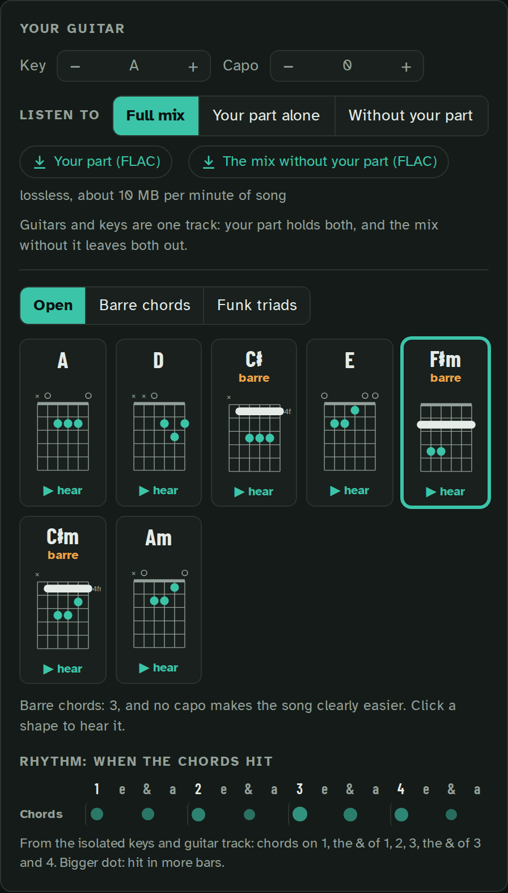
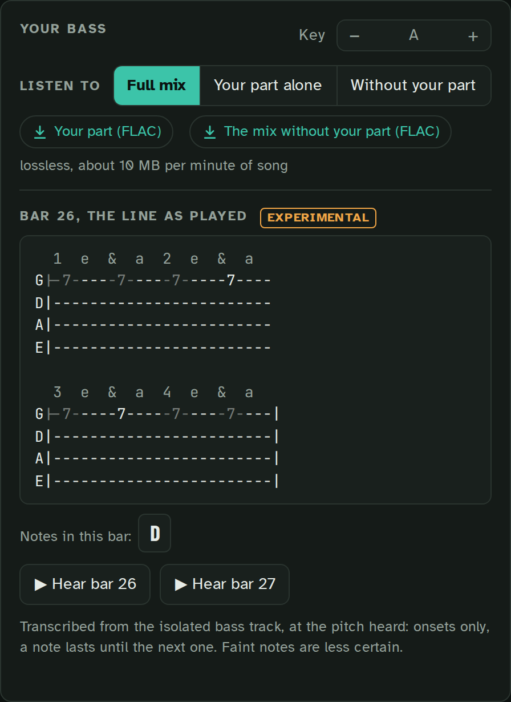
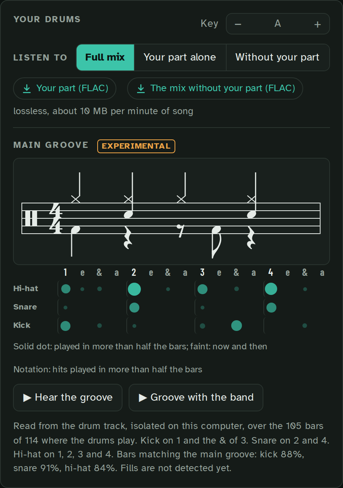
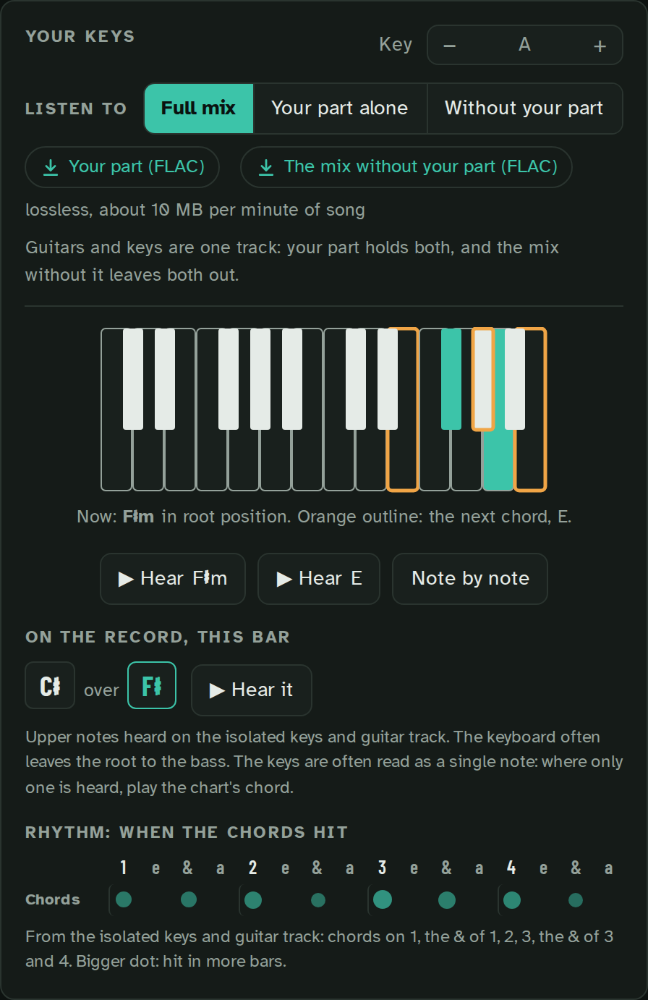
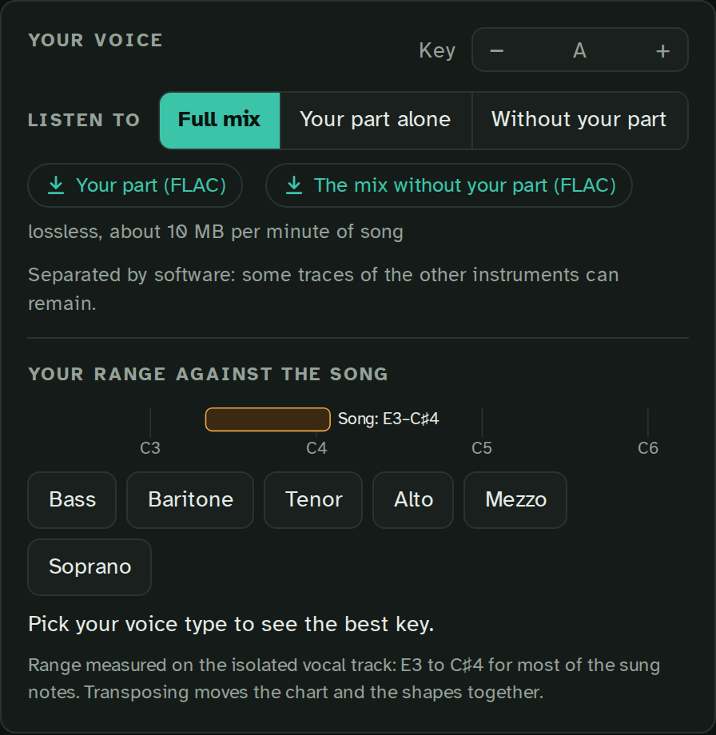
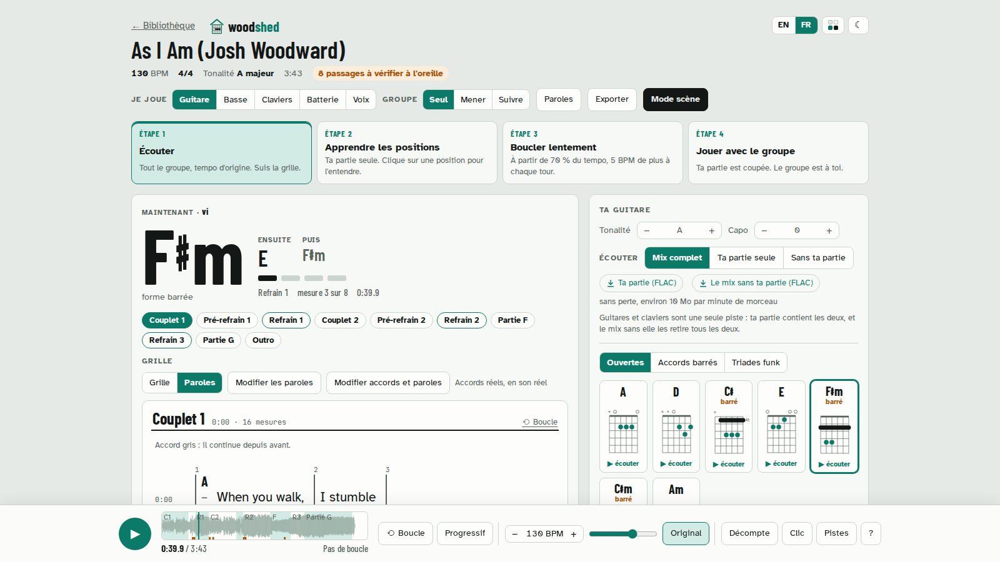
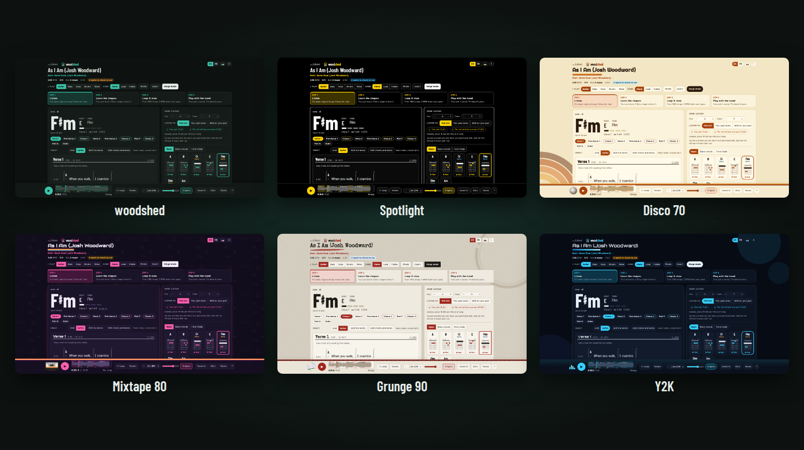

# Your part: each instrument

Each instrument has its own panel on the song page: what to play, read from the recording, and a
way to hear your part alone or the song without it. Some parts are read more surely than others,
and the page says so where it hesitates. This page says how sure each one is.

| Guitar | Bass | Drums |
|:---:|:---:|:---:|
|  |  |  |

| Keys | Voice |
|:---:|:---:|
|  |  |

## Listen to: your part alone, or the song without it

Each panel opens on **Listen to**: **Full mix**, **Your part alone** (your instrument's separated
track) or **Without your part** (the song to play over), switched while the music plays, the loop and
the tempo kept.

Two links take the files home, lossless as the page plays them (about 10 MB per minute of song):
served by the library they download as `<song> - bass alone.flac` and `<song> - without bass.flac`;
a page opened from disk opens them, and says they are already in its `audio` folder. The guitar and
the keys each have their own track; an instrument the song does not have says so ("No keys heard in
this song"), and the full mix plays. The tracks carry the page's common gain, not the original
file's level.

## Guitar and keys apart

New songs are split into six instruments: drums, bass, vocals, guitar and keys (the piano, plus
synths and organ, which land on no other track). A page holds 11 tracks instead of 9, about 20 %
more disk. To keep guitars and keys on one track, as pages made before 0.4.0 do, uncheck **Guitar
and keys apart** under **Options for the next songs** (from the command line: `--separation four`).
A page keeps the separation it was made with.

The separated tracks of a song take about 50 % more room in the cache; `woodshed cache --clear`
frees it, the old four-instrument tracks included.

## Guitar

Shapes in open, barre or funk-triad positions, barre chords tagged, the best capo for the song (the
panel names it, with the barre chords it saves, and a button to put it on), and when the chords hit
in the bar: the strumming rhythm, read from the guitar's own track. When the song changes key, the
shapes come grouped by key ("From bar 17: D♭ major"), with a word for the hands on a lift.

Guitar and keys can read the words instead of the grid (the Lyrics view, and stage mode beside the
big chord). Every line starts with a chord: bold where it changes, small and grey where it goes on
from before ("Cm" over a line in a C minor vamp), so a line with no change never reads as "nothing
found here". On stage the grey chord is shown on the lines coming, not on the one you play (the big
chord names it).

## Bass

**Rough: check by ear.** The line as played, in tab, bar by bar. Hear any bar on its own; a looped
passage shows the tab of each of its bars. The bass notes' octave was checked on real recordings,
but the tab note by note is not measured yet: the page marks it experimental, and says when the
read is unsure ("no bass heard in this bar").

## Drums

**Rough: check by ear.** The main groove in notation, from the isolated drum track, and how often
each hit happens. The text, the notation, the grid, what you hear and the MIDI all say the same
groove. Marked experimental in the page: when nothing comes back steadily, it says "no clear
groove" instead of drawing one. On one funk cover the kick and snare matched 9 bars out of 10; that
is one song, not a benchmark.

## Keys

The chord on a keyboard, the next one outlined, and the notes heard on the record in this bar.

**The readings: rough, check by ear.** The notes heard are checked against the chart, and the panel
says what the record really holds in each bar: a bar with no chord heard says so, a third that
disagrees with the chart is named ("The record has D♯ here, the chart says Bm: check this bar by
ear"), and where the keys are often read as a single note, it says to play the chart's chord there.
On a page split in six, the rhythm under the keys is the guitar's strumming, and the panel says so:
the keys' own rhythm is not read.

## Voice

The range of the melody against your voice type, and the key that suits you: see
[For singers](singers.md).

## Change the key

Change the key and everything follows: the chart, the shapes, the tab, the keyboard. The singer's
key for the whole band, and the recording in that key, are in
[For singers](singers.md#keep-the-key-for-the-band).

On a song that changes key, the Key box shows every key in order, "A → B♭", with the key of the bar
you are in lit. The text stays the same while the song plays: only the lit key moves. − and + still
move the whole song, so after + it reads "B♭ → B (+1)".

## The four steps of practice

Every page walks you through the same four steps: **listen** with the full band, **learn** your
part alone, **loop it slow** (from 70 % tempo, 5 BPM faster on each pass) and **play with the band**,
your own part muted. A count-in, a click and per-instrument tracks are one button away. Drag across
bars to loop them, use a pedal or the arrow keys to move bar by bar.

While the song plays, the page scrolls with it: your hands stay on the instrument. Scroll ahead by
hand to read on, and **Back to the song** brings the page back to where the band is.

## The keyboard

The keyboard does what it says.

- **Space** plays or pauses (a page-turner pedal sends it), except on a button you reached with
  Tab, which it presses as anywhere on the web. A click anywhere gives Space back to the music.
- **The chart's bars** are one Tab stop: the arrows move bar by bar and line by line, **Home** and
  **End** go to the part's first and last bar, **Enter** goes to a bar (or opens its check by ear).
- **In the bar editor**, **Enter** saves, and **Ctrl+Enter** (**⌘+Enter** on a Mac) saves and opens
  the next bar.
- **N** takes the band to the next song of the set.
- **The page follows you**: with the song stopped, the page scrolls to the bar you move to with the
  arrows, and the arrows go on from that bar. The keyboard stays on a button you press (an
  instrument, a step, **Edit the chart**), and comes back to **Stage mode** when you leave the stage.
  A screen reader says which instrument is pressed.

## English or French, dark or light

The page speaks English or French (your browser's language at first), dark by default or light for
a sunny room: two buttons at the top, remembered, and switched without stopping the music. Chord
names, titles and words are never translated.

The **Style** button beside them (four small squares) changes the whole look, on this device only:
**woodshed**, **Spotlight** (the most contrast: black on white in the sun, white and yellow on black on
a dark stage), **Disco 70**, **Mixtape 80**, **Grunge 90** and **Y2K**. Each works dark or light. The
chords and the words keep their fonts in every style; stage mode and the printout stay plain, and
nothing moves if your system asks for less motion.
