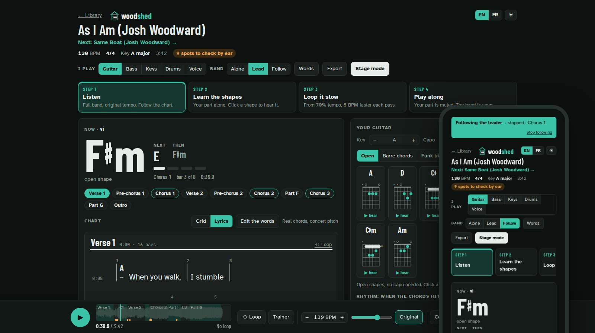
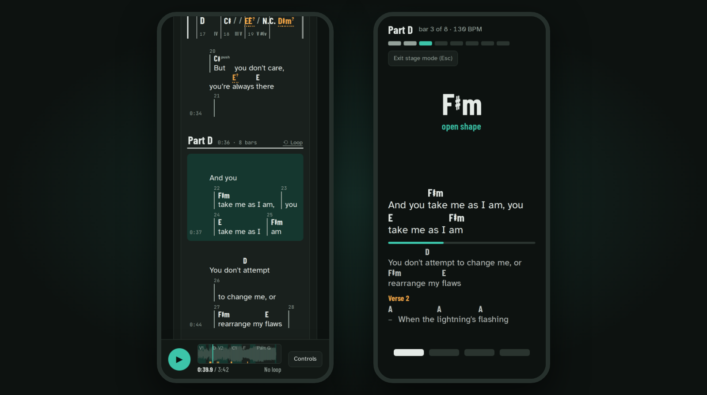

# The band: phones, stage and set list

One computer runs woodshed; every phone and tablet in the room opens the songs from it, over the
Wi-Fi. Nothing goes to the internet.

## Let the band's phones join

In the library, press **Let the band's phones join**. It shows this computer's address and a code
to scan: on each phone, on the same Wi-Fi, scan it with the camera (or type the address), open the
song and press **Follow**.

The first time, your computer may ask whether woodshed (or Python) may accept incoming connections:
allow it on private networks (on Windows, the "Windows Security" box: tick **Private networks** and
click **Allow access**).

If Windows calls this Wi-Fi a Public network (a phone hotspot or a venue's Wi-Fi usually is), make
it Private first: **Settings** > **Network & internet** > **Wi-Fi** > the network > **Private
network**.

The phones can play, lead and follow, not add songs, and the button lets
them out again. From a terminal, `woodshed app --host 0.0.0.0 --allow-network` starts the library
already open to the network.

With Docker, publish the port to the network instead: in `compose.yaml`, `"8000:8000"` in place of
`"127.0.0.1:8000:8000"`.

## Lead and follow

One device leads, every phone on the network follows to the bar. Start, stop, loop and seek once,
for the whole band.

Any device can take over: tap Lead on a phone that follows and the song goes on from where the band
is, playing or stopped. The sound moves with the lead: only the device that leads plays, so the old
leader goes quiet and follows. If two of you tap Lead at the same moment, the first one leads and
the other is told and keeps following.

## Stage mode

The chord now and next in huge type, the words, where you are in the section. Readable from the
drum stool, with big buttons for a tablet: previous part, play, next part. The singer's stage is
described in [For singers](singers.md#on-stage).

  

## The set list

Line up the evening's songs, with each one's key, tempo and length, the set's total time and a note
per song ("capo 2, starts on the chorus"; it belongs to the set and goes when the song leaves it),
and print it. At the end of a song, the pedal (or `N`) takes the whole band to the next one.

The singer's key for the band is in [For singers](singers.md#keep-the-key-for-the-band).

## Phones on the music stand

While a phone follows, leads or shows the stage view, woodshed keeps its screen on: with the
browser's Screen Wake Lock on a secure page, otherwise with a tiny silent video playing in the page
(it starts at the first touch after a song change). It is best effort: the phone's system decides,
Low Power Mode or Battery Saver can refuse it, and the video costs battery, so plug the phones in for
a long rehearsal.

A follower whose screen may still lock sees one line saying where to turn its sleep off (Settings →
Display & Brightness → Auto-Lock → Never on an iPhone, where Low Power Mode greys "Never" out; Screen
timeout on Android), until a touch keeps the screen on or you close it.

## HTTPS for the phones (optional)

Over the Wi-Fi's plain `http://` address, phones have no Screen Wake Lock. Served over HTTPS they
do. This is the one part of woodshed that asks for a few terminal commands; the screen-on video
above works without it.

With [mkcert](https://github.com/FiloSottile/mkcert) on the computer: `mkcert -install`, then
`mkcert 192.168.1.20 localhost 127.0.0.1` with this computer's address on the band's network (a
name such as `mylaptop.local` works too, though Android often cannot resolve `.local` names: the
address is the safe choice), and start
`woodshed app --cert 192.168.1.20+2.pem --key 192.168.1.20+2-key.pem` (or set `WOODSHED_CERT` and
`WOODSHED_KEY`). Keep both files outside the library folder: woodshed refuses a key it would serve.
The library page then shows `https://` addresses and code.

Each phone must trust mkcert's root, `rootCA.pem` from `mkcert -CAROOT` (share that file only,
never `rootCA-key.pem`):

- **iPhone**: send it by AirDrop or mail, install the profile in Settings (General → VPN & Device
  Management on recent iOS), then General → About → Certificate Trust Settings: turn on full trust.
- **Android**: Settings → Security → Encryption & credentials → Install a certificate → CA
  certificate (the menu names vary; a screen lock is required, and the file may need a `.crt` name).
  Chrome trusts it; Firefox for Android does not by default. A "network may be monitored" notice
  appears.

Remove the root from the phones after the gig: anything that trusts it trusts every certificate
your mkcert makes. The address in the certificate must be the one the phones type: give the
computer a fixed address on the router, or make a new certificate after joining another network.
mkcert's certificates last a little over two years. An old `http://` bookmark no longer answers.

The computer itself still opens `http://127.0.0.1:8000`, except when the whole library listens on
the network (`--host 0.0.0.0`, or Docker): then it is `https://localhost:8000` too, and the
certificate must include `localhost` and `127.0.0.1`.

**With Docker**: put the two files in a `certs` folder next to `compose.yaml` (not inside
`woodshed`), and follow the comment in `compose.yaml`.

## No Wi-Fi in the room

Turn on a phone's hotspot, join it from the computer and the other phones, and let the band's
phones join again: the library page shows the address on that network (not last time's).

## iPad and tablets

A tablet opens the library like a phone: on the same Wi-Fi as the computer running woodshed, scan
the code or type the address the library page shows (**Let the band's phones join**), in Safari.
Your part, the stage view and following the leader are meant to work there as on a phone; over the
Wi-Fi's plain `http://` the screen may lock, as on a phone (turn Auto-Lock off, or use
[HTTPS](#https-for-the-phones-optional)).

There is no practice on the iPad alone: the computer has to be on, on the same network. iOS starts
a sound only from a tap: a tap on the page lets every track play later, and if a switch is still
refused, the music goes on and the page asks for another tap. This is checked in WebKit, Safari's
engine, not yet on a real iPad. iPad users report that Safari opens an HTML file from the Files app
without the files next to it, so a page folder copied to an iPad is not expected to play.

Something not working? See [the phones](troubleshooting.md#the-phones) in troubleshooting.
