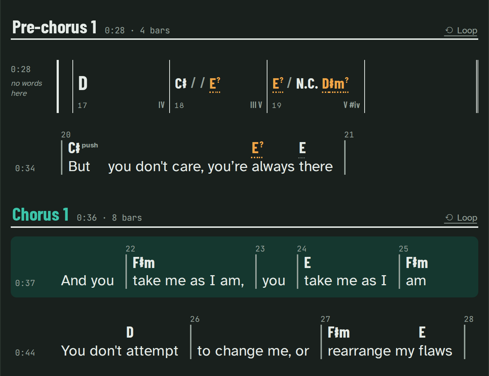

# For singers

Paste the words, pick **Voice**, find your key, and the whole band plays in it: the chart, the
shapes, every phone, and the recording itself.

## The words, with the chords above them

In the library, a song with its parts offers **add the words**; on its page, **+ Add the words**
next to the chart. Paste them (part names like `[Chorus]` help; one line per sung line), press
**Place the words**: woodshed places them on the singer's voice, line by line (a progress bar shows
how far it is), and a minute later the page shows each chord above the word it lands on. The first
time takes longer: the model that listens to the voice is downloaded once.

Bar lines are numbered, pushes are marked, and the line being sung lights up as the song plays.
Click a word to jump there. Instrumental bars stay a grid, so a solo never hides inside a lyric
line.

A chord is written where it changes. A line that opens on a chord still sounding from before shows
it anyway, small and grey over its first word ("Cm", or "N.C." when nothing is played): a grey chord
means "keep playing it", a bold one is a change. One line above the words says so, and a screen
reader hears each line's opening chord ("still Cm"). The singer's stage keeps to the words.

From the command line, or for a page opened from disk: `woodshed lyrics "Song.woodshed" words.txt`.

What the words need:

- Latin letters only (most accented letters are fine).
- Numbers written out as words ("twenty", not "20").
- The song built with its instrument tracks, since the words are placed on the singer's own track.

The model that places the words is free for non-commercial use only: if your band is paid to play,
read [the licences](how-it-works.md#models-and-licences) first.

## Your voice type and your key

Pick **Voice**: the page opens on the words, with the next part named. The panel shows the range of
the melody against your voice type, and the key that suits you. Pick your voice type and
**Transpose to** the key it suggests. Change the key and everything follows: the chart, the guitar
shapes, the bass tab, the keyboard.

When the song changes key (a last chorus lifted a semitone), the voice panel says "Up a semitone at
bar 82: B♭ major." before you pick a key, then what the ending asks of your voice:

- its own range, drawn as a dashed bar under the song's ("From bar 82: F3–B♭3"), with the notes
  named in its key;
- one sentence: "From bar 82 you sing F3 to B♭3: no higher than the rest of the song.", or, in the
  warning colour, "From bar 82 it goes higher: up to D4." (or lower). Under 8 sung notes the ending
  is too short to measure, and the page says so.

The key it suggests fits the whole range, the ending included. Songs added before this version get
the ending's range a few seconds after the library starts (it is measured on the song's own vocal
track, in the background); a page open meanwhile loads it again once you stop playing.

## Keep the key for the band

Then, on the song's page opened from the library, **Keep E♭ for the band** (the button names your key): every device opens the
song in it. Served by the library, the recording follows too (see below); a page opened from disk
keeps its own key, and the page says so.

## The recording in your key

Served by the library, a transposed page offers **Play the recording 2 semitones up** (on by default
for the voice, and for everyone in the band's saved key). The library renders each track in that
key, one at a time, about 10 s per minute of song, the track you play first: the original plays
meanwhile and the page swaps to the new one at the same place, without stopping. While it renders,
the page says the recording catches up in a few seconds.

The tracks stay in tune, as long and at their level (a track already at the loudest is made a little
quieter rather than clipped); the drums alone play as recorded. A page opened from disk plays the
recording in its own key. Each page keeps the band's key, the two most recently asked others and any
key a device played in the last minute; the downloads stay the original files.

### What it needs

It works out of the box with the installers: on a Mac and on Windows they add the Rubber Band
program woodshed uses to change the key, with no extra step. On Linux and in Docker, ffmpeg has it
(`sudo apt install ffmpeg`). The library page says when it is missing and the one step that adds it
(see [the singer's key](troubleshooting.md#the-singers-key) in troubleshooting);
`woodshed app --no-pitch` turns it off.

## On stage

Tap a line's time to sing from there. Stage mode shows the words big, your line lit at the top, and
the next part coming. Stopped, the line you sing next comes first, marked **Next:** (also after
**Part ⏭**). A key change is announced before you reach it.

## ChordPro for OnSong

The ChordPro export (OnSong, SongbookPro) is in the key the page shows, the band's key included,
and reads as a sheet: a sung line is never cut by a row of chords, N.C. (no chord) is never a chord
to transpose, repeated rows are folded ("x2"), and a key change is said where it happens. More
formats in [exports](exports.md).
